# Exploratory final failure analysis — 12 October 2026

**Step 4 complete: all final corridor events examined; no threshold, frozen result or estimator changed. Mechanisms and publication novelty remain unproven.**

Read and hash-checked consumed streams from all 192 completed corridor/control native slots. Reused the frozen reference association, primary windows, recovery labels and causal state machine. All 96 corridor labels and 192 diagnostic event rows exactly reproduce the accepted final analyses. This is a post-result investigation, not a new confirmatory study or independent review.

## What “missed recovery” means

The frozen endpoint requires a **new confirmed-healthy transition after retrospective recovery onset**, before relapse/deadline. An already-active healthy state can therefore coexist with a missed new declaration. Such an event is not equivalent to a detector remaining unhealthy. This distinction was not introduced to repair outcomes: the rule and all original counts are unchanged.

| Backend / policy | Missed recoveries | No raw healthy tick | Raw healthy, no three-record confirmation | Active state, no new post-onset transition |
| --- | ---: | ---: | ---: | ---: |
| fastlio / scalar | 32 | 30 | 2 | 0 |
| fastlio / fixed Schur | 8 | 5 | 2 | 1 |
| pointlio / scalar | 5 | 3 | 0 | 2 |
| pointlio / fixed Schur | 7 | 2 | 0 | 5 |

All missed-event recovery intervals contain available decision ticks. These mutually exclusive classes describe observable policy behavior, not physical causes. “Active state” means active at some time in the recovered interval, with no qualifying new transition; it need not remain active for the whole interval.

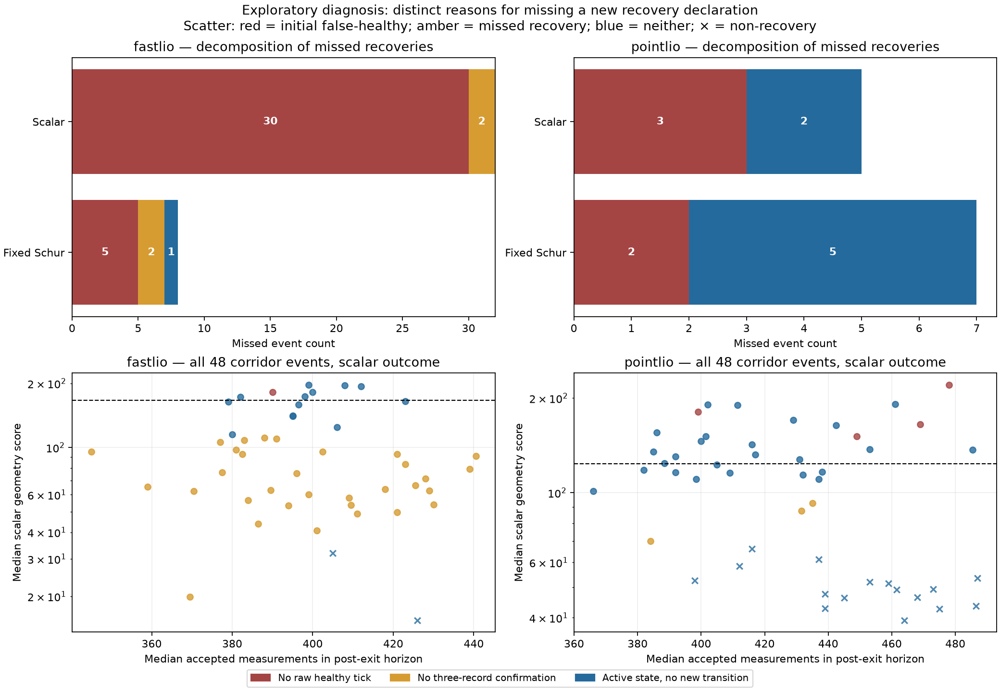

The top bars partition every missed recovery. The bottom scatter includes all 48 corridors per backend: red marks an initial false-healthy event, amber a missed recovery without an initial false-healthy event, blue neither; crosses mark non-recovery. Red takes priority if event categories overlap. Dashed lines show the locked scalar thresholds. A median over the whole post-exit horizon is descriptive and does not reconstruct a particular tick or determine the event label.

## Initial false-healthy behavior

| Backend / policy | Initial false-healthy events | Active at first initial-interval tick | With a new transition inside initial interval |
| --- | ---: | ---: | ---: |
| fastlio / scalar | 1 | 0 | 1 |
| fastlio / fixed Schur | 4 | 0 | 4 |
| pointlio / scalar | 4 | 2 | 2 |
| pointlio / fixed Schur | 16 | 3 | 13 |

The initial endpoint counts active health before sustained recovery onset, including carried-in state. Onset is retrospective and only known after three passing windows. A premature healthy tick is not proof that an instantaneous pose error is large: an interval can precede the first qualifying sustained triple even while some local windows are accurate. The timeline’s later window-end error samples must not be read as online information at the earlier tick. The two descriptive columns above are not generally guaranteed to be mutually exclusive.

## Measurement support and score scaling

For every scene, take medians over valid diagnostic records in the fixed [exit, exit + 20 s) horizon. The table then takes the median across corridor events within the displayed, post-result outcome group. Counts are accepted measurement rows under each backend’s own instrumentation; compare within a backend, not as a cross-backend point-density ranking.

| Backend / scalar outcome group | Events | Median of event median accepted counts | Median of event median scalar scores |
| --- | ---: | ---: | ---: |
| fastlio / recovered, missed | 32 | 397.50 | 65.927 |
| fastlio / recovered, detected | 14 | 397.25 | 168.790 |
| fastlio / non-recovered | 2 | 415.50 | 23.651 |
| pointlio / recovered, missed | 5 | 431.50 | 92.674 |
| pointlio / recovered, detected | 27 | 411.50 | 134.909 |
| pointlio / non-recovered | 16 | 456.00 | 49.180 |

FAST scalar misses and detections have almost identical group median accepted counts, but different group median scores. Point non-recoveries have more accepted rows at the group-median level than its recovered/detected group. These summaries do not support a simple monotonic “more accepted measurements means recovered” account. They do not rule out effects of directional distribution, correspondence quality, visibility, biases or map history.

The scalar geometry score already includes accepted-count normalization and the fixed 3 m rotation lever scale. Holding those formulas fixed allows score/decision behavior to be inspected; it does not calibrate physical uncertainty or identify a scaling defect. The recorded six Schur flags and their fraction are retained in the exports. They describe detector-defined eigenspace degeneracy, not independently verified world-axis observability. No final rescaling or alternative threshold was tried.

## Every failure remains visible

| Method | Initial false-healthy seeds | Missed recovery seeds | Non-recovery seeds |
| --- | --- | --- | --- |
| FASTLIO_MIN_EIG_G3 | 10000 | 10001, 10002, 10004, 10005, 10008, 10009, 10010, 10011, 10100, 10104, 10106, 10110, 10111, 10117, 10118, 10203, 10206, 10207, 10208, 10210, 10213, 10300, 10303, 10304, 10306, 10307, 10310, 10311, 10312, 10315, 10316, 10318 | 10105, 10112 |
| DCREG_SCHUR_MASK | 10002, 10105, 10203, 10212 | 10003, 10009, 10117, 10203, 10207, 10304, 10306, 10315 | 10105, 10112 |
| POINTLIO_MIN_EIG_G3 | 10202, 10203, 10207, 10213 | 10009, 10104, 10106, 10207, 10213 | 10105, 10107, 10110, 10111, 10112, 10116, 10117, 10118, 10303, 10304, 10305, 10306, 10307, 10312, 10315, 10316 |
| POINTLIO_DCREG_SCHUR_MASK | 10002, 10009, 10106, 10107, 10112, 10116, 10200, 10202, 10203, 10210, 10213, 10304, 10305, 10307, 10312, 10316 | 10000, 10002, 10106, 10200, 10202, 10203, 10213 | 10105, 10107, 10110, 10111, 10112, 10116, 10117, 10118, 10303, 10304, 10305, 10306, 10307, 10312, 10315, 10316 |

A seed can appear in more than one column and method. Non-recovery is not a recovery-detection miss. Relapse remains in the unchanged accepted event rows. Full flags, interval fractions, scores, control summaries and geometry dimensions are in [event diagnosis](event_diagnosis.csv); all primary windows and causal ticks are retained, including successful cases. No failed native slot was discarded; the two earlier workflow failures are documented in the accepted results and are not new native samples.

## Illustrated timelines

Choose the lowest selected seed per backend/method for initial false-healthy, missed recovery, successful detection, non-recovery and each observed miss-pattern category. Deduplicate backend/seed pairs. This deterministic rule was selected after results and only chooses illustrations; all events determine the summaries. The [selection receipt](case_selection.json) records every category and seed.

Each plot has five aligned panels: accepted count with paired control; scalar score and locked threshold with paired control; corridor Schur score with the fixed 0.1 score boundary; primary local translation/rotation errors divided by their frozen limits; and confirmed-health states/new transition triangles. Errors are plotted at the actual window end, and only post-exit primary windows are shown. Blank pre-exit error space is not zero error. Log/symmetric-log axes preserve visible ranges; unavailable values remain gaps. Black is the independently fixed exit; green dashed is retrospective onset, green dotted its truth confirmation, purple a relapse when present. Truth does not feed the causal diagnostic.

### fastlio seed 10000

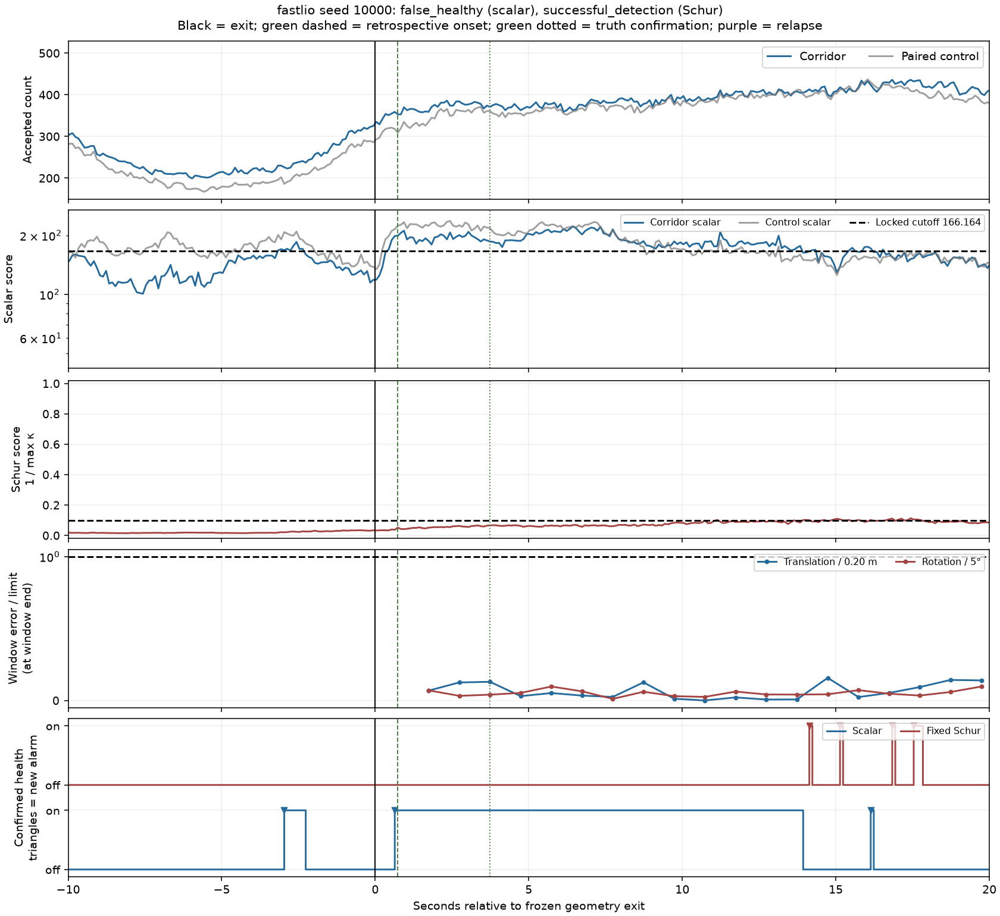

Illustrates: false_healthy (scalar), successful_detection (Schur).

- FASTLIO_MIN_EIG_G3: truth RECOVERED; initial false-healthy True; post-onset detection True; observed miss pattern `NOT_A_MISSED_RECOVERY`.
- DCREG_SCHUR_MASK: truth RECOVERED; initial false-healthy False; post-onset detection True; observed miss pattern `NOT_A_MISSED_RECOVERY`.

### fastlio seed 10001

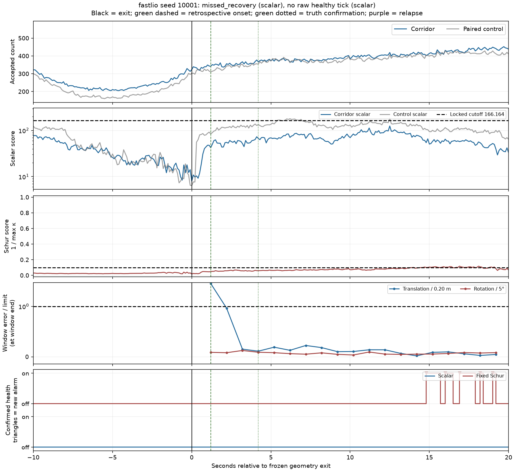

Illustrates: missed_recovery (scalar), no raw healthy tick (scalar).

- FASTLIO_MIN_EIG_G3: truth RECOVERED; initial false-healthy False; post-onset detection False; observed miss pattern `NO_RAW_HEALTHY_TICK_IN_RECOVERY_INTERVAL`.
- DCREG_SCHUR_MASK: truth RECOVERED; initial false-healthy False; post-onset detection True; observed miss pattern `NOT_A_MISSED_RECOVERY`.

### fastlio seed 10002

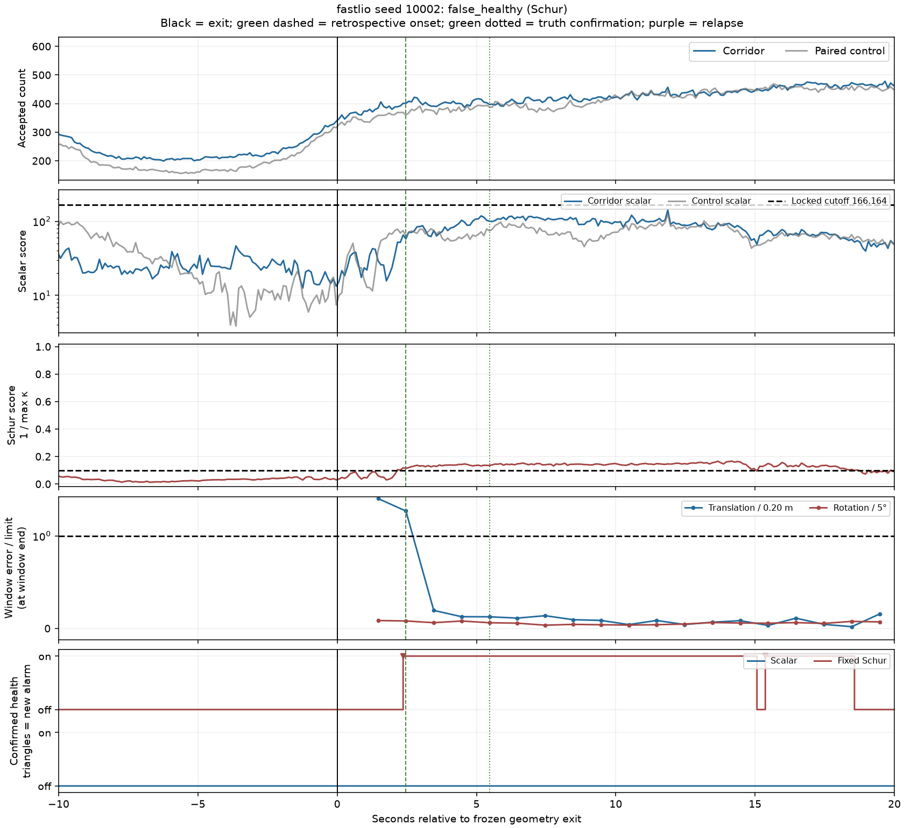

Illustrates: false_healthy (Schur).

- FASTLIO_MIN_EIG_G3: truth RECOVERED; initial false-healthy False; post-onset detection False; observed miss pattern `NO_RAW_HEALTHY_TICK_IN_RECOVERY_INTERVAL`.
- DCREG_SCHUR_MASK: truth RECOVERED; initial false-healthy True; post-onset detection True; observed miss pattern `NOT_A_MISSED_RECOVERY`.

### fastlio seed 10003

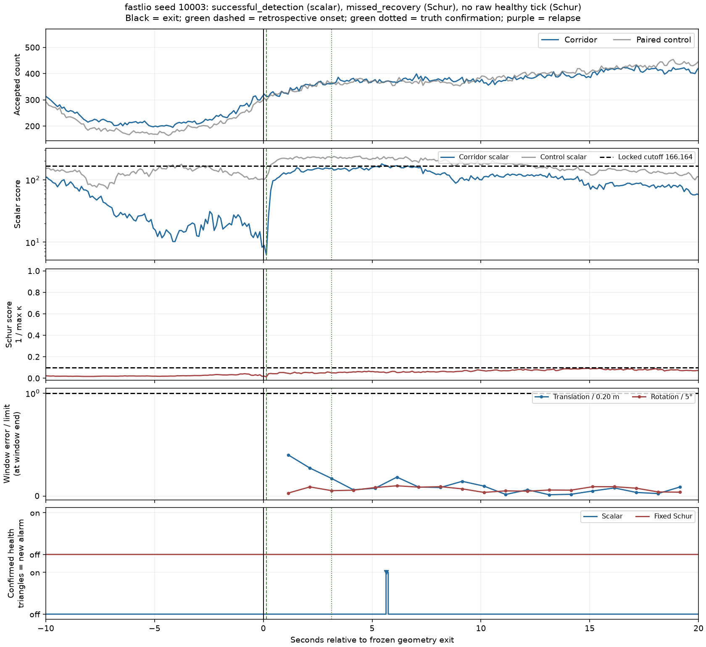

Illustrates: successful_detection (scalar), missed_recovery (Schur), no raw healthy tick (Schur).

- FASTLIO_MIN_EIG_G3: truth RECOVERED; initial false-healthy False; post-onset detection True; observed miss pattern `NOT_A_MISSED_RECOVERY`.
- DCREG_SCHUR_MASK: truth RECOVERED; initial false-healthy False; post-onset detection False; observed miss pattern `NO_RAW_HEALTHY_TICK_IN_RECOVERY_INTERVAL`.

### fastlio seed 10010

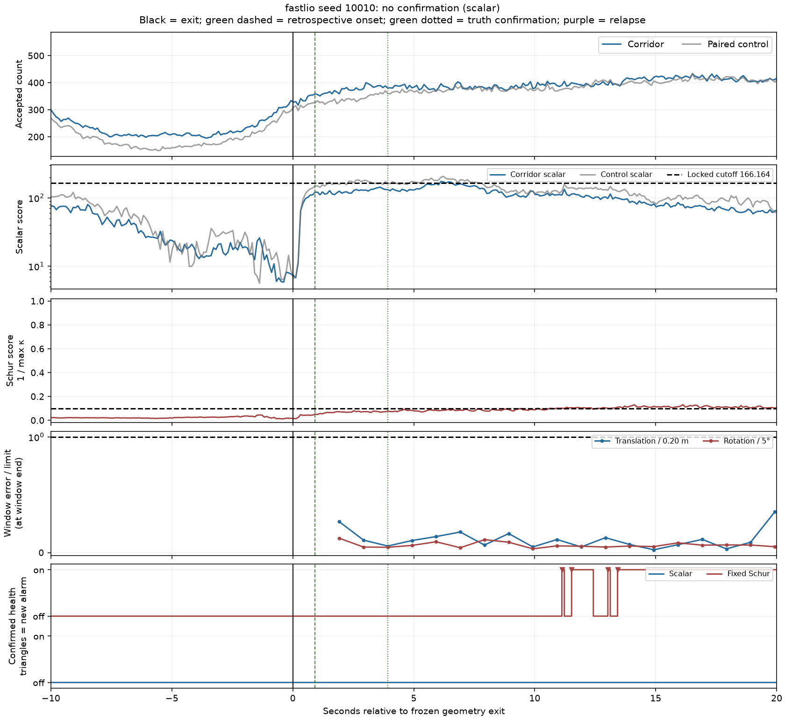

Illustrates: no confirmation (scalar).

- FASTLIO_MIN_EIG_G3: truth RECOVERED; initial false-healthy False; post-onset detection False; observed miss pattern `RAW_HEALTHY_TICKS_WITHOUT_THREE_RECORD_CONFIRMATION`.
- DCREG_SCHUR_MASK: truth RECOVERED; initial false-healthy False; post-onset detection True; observed miss pattern `NOT_A_MISSED_RECOVERY`.

### fastlio seed 10105

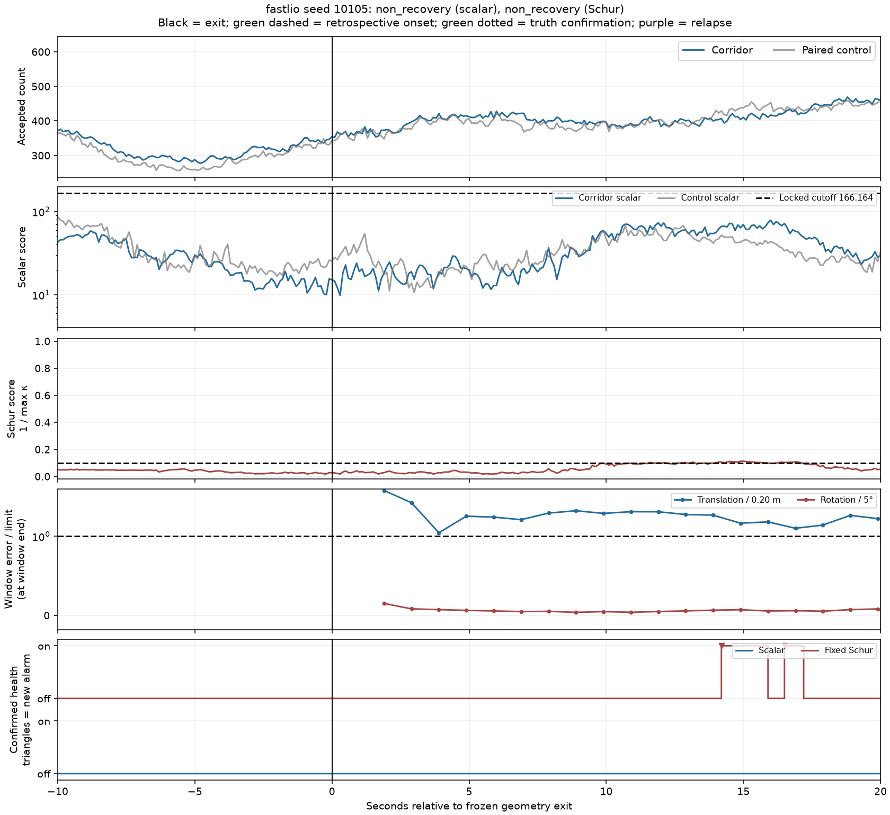

Illustrates: non_recovery (scalar), non_recovery (Schur).

- FASTLIO_MIN_EIG_G3: truth NO_RECOVERY_WITHIN_HORIZON; initial false-healthy False; post-onset detection False; observed miss pattern `NOT_A_MISSED_RECOVERY`.
- DCREG_SCHUR_MASK: truth NO_RECOVERY_WITHIN_HORIZON; initial false-healthy True; post-onset detection False; observed miss pattern `NOT_A_MISSED_RECOVERY`.

### fastlio seed 10117

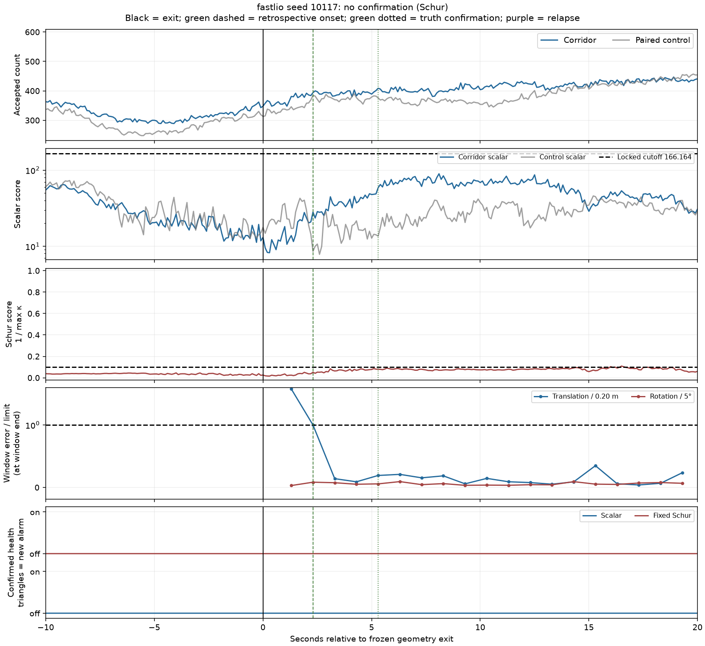

Illustrates: no confirmation (Schur).

- FASTLIO_MIN_EIG_G3: truth RECOVERED; initial false-healthy False; post-onset detection False; observed miss pattern `NO_RAW_HEALTHY_TICK_IN_RECOVERY_INTERVAL`.
- DCREG_SCHUR_MASK: truth RECOVERED; initial false-healthy False; post-onset detection False; observed miss pattern `RAW_HEALTHY_TICKS_WITHOUT_THREE_RECORD_CONFIRMATION`.

### fastlio seed 10203

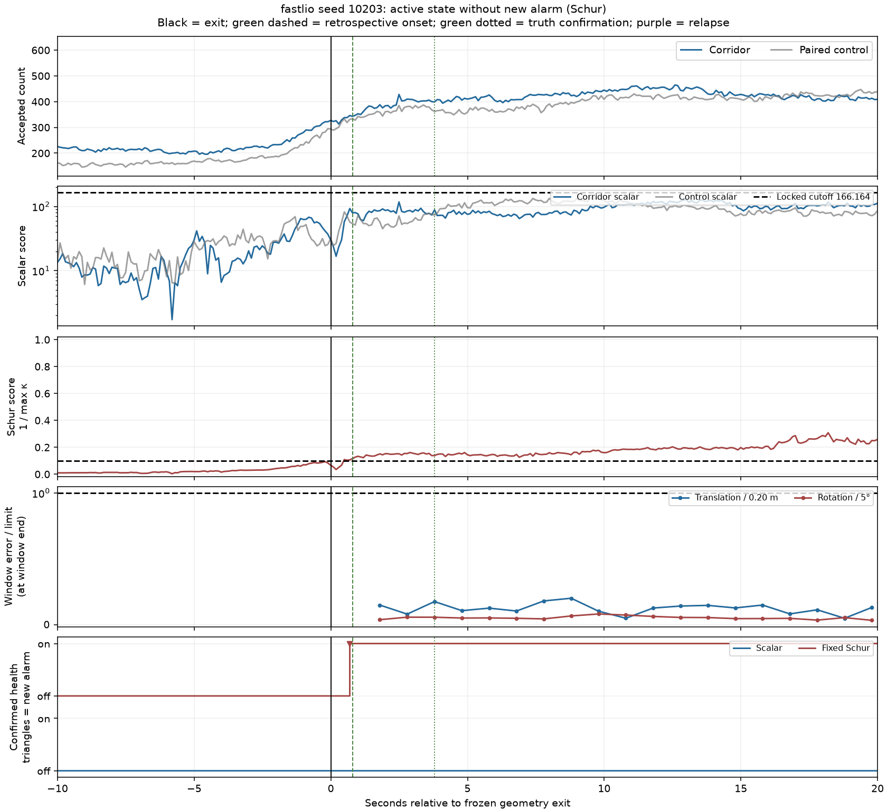

Illustrates: active state without new alarm (Schur).

- FASTLIO_MIN_EIG_G3: truth RECOVERED; initial false-healthy False; post-onset detection False; observed miss pattern `NO_RAW_HEALTHY_TICK_IN_RECOVERY_INTERVAL`.
- DCREG_SCHUR_MASK: truth RECOVERED; initial false-healthy True; post-onset detection False; observed miss pattern `ACTIVE_STATE_WITHOUT_NEW_POST_ONSET_TRANSITION`.

### pointlio seed 10000

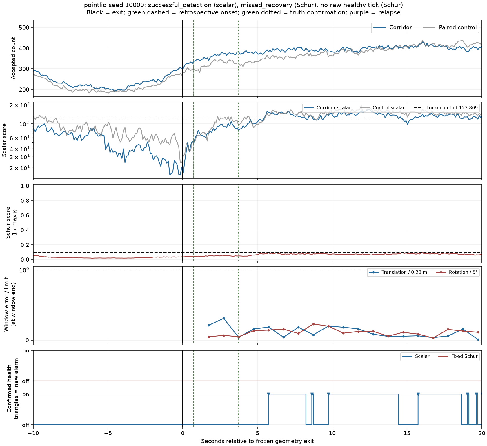

Illustrates: successful_detection (scalar), missed_recovery (Schur), no raw healthy tick (Schur).

- POINTLIO_MIN_EIG_G3: truth RECOVERED; initial false-healthy False; post-onset detection True; observed miss pattern `NOT_A_MISSED_RECOVERY`.
- POINTLIO_DCREG_SCHUR_MASK: truth RECOVERED; initial false-healthy False; post-onset detection False; observed miss pattern `NO_RAW_HEALTHY_TICK_IN_RECOVERY_INTERVAL`.

### pointlio seed 10001

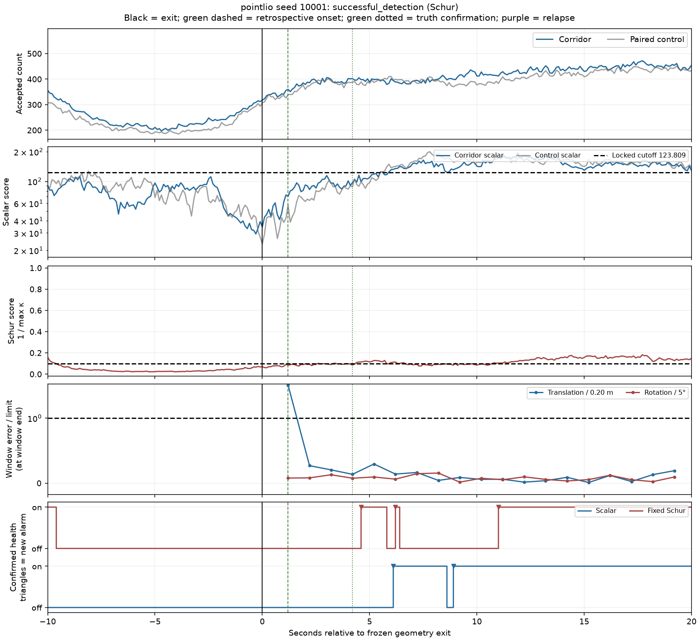

Illustrates: successful_detection (Schur).

- POINTLIO_MIN_EIG_G3: truth RECOVERED; initial false-healthy False; post-onset detection True; observed miss pattern `NOT_A_MISSED_RECOVERY`.
- POINTLIO_DCREG_SCHUR_MASK: truth RECOVERED; initial false-healthy False; post-onset detection True; observed miss pattern `NOT_A_MISSED_RECOVERY`.

### pointlio seed 10002

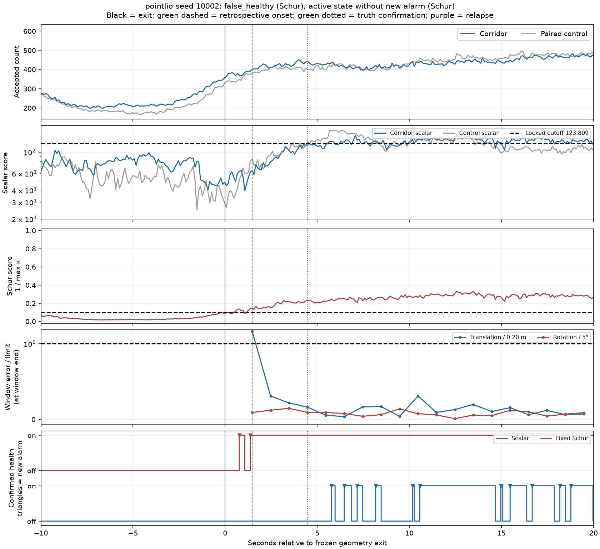

Illustrates: false_healthy (Schur), active state without new alarm (Schur).

- POINTLIO_MIN_EIG_G3: truth RECOVERED; initial false-healthy False; post-onset detection True; observed miss pattern `NOT_A_MISSED_RECOVERY`.
- POINTLIO_DCREG_SCHUR_MASK: truth RECOVERED; initial false-healthy True; post-onset detection False; observed miss pattern `ACTIVE_STATE_WITHOUT_NEW_POST_ONSET_TRANSITION`.

### pointlio seed 10009

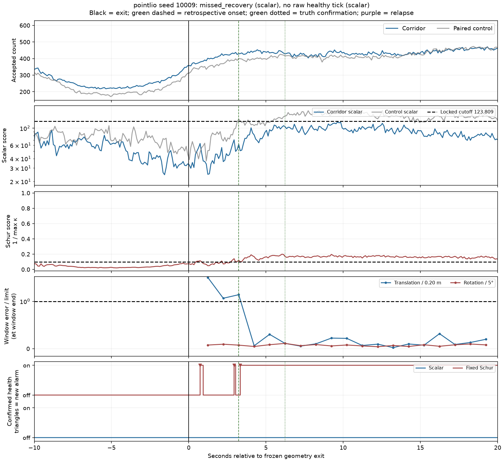

Illustrates: missed_recovery (scalar), no raw healthy tick (scalar).

- POINTLIO_MIN_EIG_G3: truth RECOVERED; initial false-healthy False; post-onset detection False; observed miss pattern `NO_RAW_HEALTHY_TICK_IN_RECOVERY_INTERVAL`.
- POINTLIO_DCREG_SCHUR_MASK: truth RECOVERED; initial false-healthy True; post-onset detection True; observed miss pattern `NOT_A_MISSED_RECOVERY`.

### pointlio seed 10105

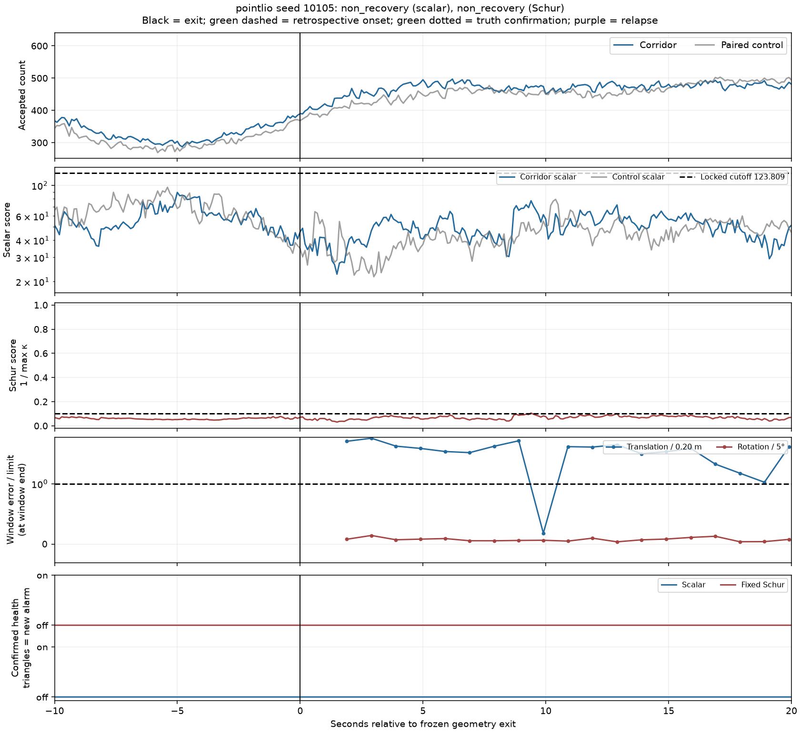

Illustrates: non_recovery (scalar), non_recovery (Schur).

- POINTLIO_MIN_EIG_G3: truth NO_RECOVERY_WITHIN_HORIZON; initial false-healthy False; post-onset detection False; observed miss pattern `NOT_A_MISSED_RECOVERY`.
- POINTLIO_DCREG_SCHUR_MASK: truth NO_RECOVERY_WITHIN_HORIZON; initial false-healthy False; post-onset detection False; observed miss pattern `NOT_A_MISSED_RECOVERY`.

### pointlio seed 10202

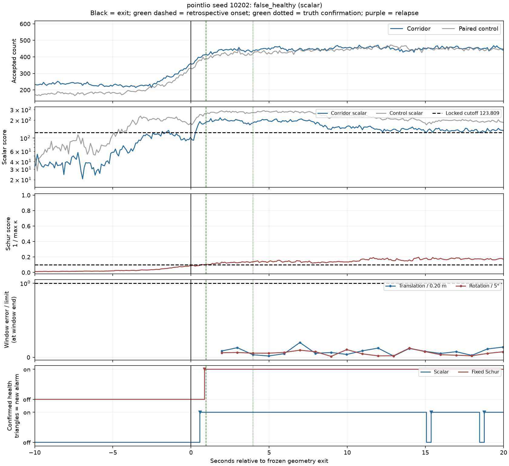

Illustrates: false_healthy (scalar).

- POINTLIO_MIN_EIG_G3: truth RECOVERED; initial false-healthy True; post-onset detection True; observed miss pattern `NOT_A_MISSED_RECOVERY`.
- POINTLIO_DCREG_SCHUR_MASK: truth RECOVERED; initial false-healthy True; post-onset detection False; observed miss pattern `ACTIVE_STATE_WITHOUT_NEW_POST_ONSET_TRANSITION`.

### pointlio seed 10207

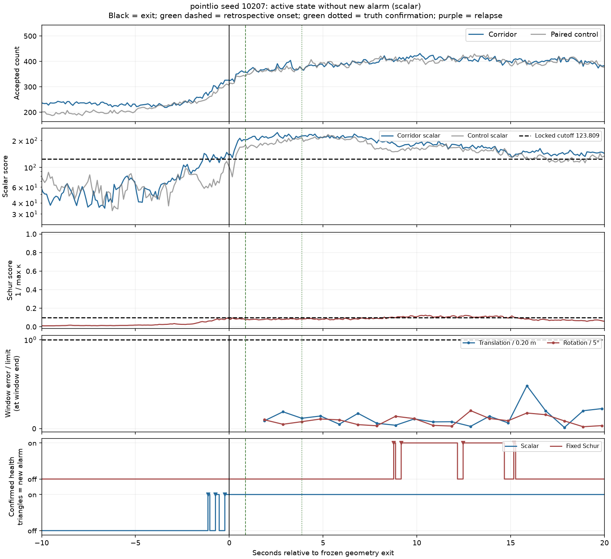

Illustrates: active state without new alarm (scalar).

- POINTLIO_MIN_EIG_G3: truth RECOVERED; initial false-healthy True; post-onset detection False; observed miss pattern `ACTIVE_STATE_WITHOUT_NEW_POST_ONSET_TRANSITION`.
- POINTLIO_DCREG_SCHUR_MASK: truth RECOVERED; initial false-healthy False; post-onset detection True; observed miss pattern `NOT_A_MISSED_RECOVERY`.

## Interpretation and next decision

The available evidence supports writing a bounded empirical evaluation of fixed-policy trade-offs, including the important distinction between recovered motion, active healthy state and a new recovery declaration. The investigation identifies decision-level explanations for misses and rejects a simplistic count-only story at the displayed group-summary level. It does not establish the physical reason for the width pattern or prove a novel mechanism.

A manuscript can report these findings with the existing protocol/exposure disclosures. A stronger causal width or measurement-normalization claim would need a new, development-validated and frozen factor-controlled study on fresh geometry IDs. No such experiment, comparator or sample expansion was run here. Publication novelty still requires scientific review against the closest literature.

## Verification and reproduction

All consumed native manifests, pose/diagnostic streams and reference/metadata bytes were rehashed. All own-backend labels and event rows exactly matched the independently audited exports. Raw bags, Jacobian sidecars and offline evaluation CSVs were not reprocessed for this exploratory task. Five analytic miss-classification fixtures passed; the full suite ran 254 tests: 253 passed, one optional SciPy skip, with native reset compilation enabled. [Test log](regression_tests.log). This is author verification, not independent acceptance of the new analysis.

From repository root, use the recorded isolated Python and fresh output directories:

```bash
"$RESEARCH_PY" research_paper/experiments/src/analyze_final_failure_cases.py \
  --root "$FINAL_ROOT" --output /tmp/failure-analysis-reproduction
"$RESEARCH_PY" research_paper/experiments/src/plot_final_failure_cases.py \
  --evidence /tmp/failure-analysis-reproduction --output /tmp/failure-figures-reproduction
```

The plotter additionally reads the accepted analysis JSON files from the repository’s `research_paper/evidence/final_geometry_v2_results_20261012` directory and verifies their recorded hashes. The [report generator](../../experiments/src/write_final_failure_report.py) presents the checked-in exports and figures from repository root. [Analysis manifest](manifest.json) binds consumed files and derived outputs; [figure manifest](../../figures/final_failure_analysis_20261012/manifest.json) binds the images and selection. No frozen scientific file was modified.
