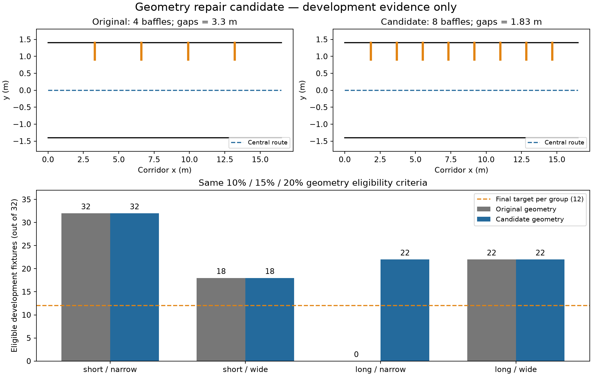

# Geometry repair checkpoint — 12 October 2026

**Candidate implemented and development-tested; revised final protocol not accepted.** The original scene screen stopped at 34/48 pairs. Final estimator runs remain unexecuted. Preserve the original frozen source and review as historical accepted evidence; their PASS does not cover this candidate.

## Diagnosis and bounded change

The original control always has four partial baffles. Its spacing grows with corridor length, while its width shrinks with corridor width. The failed long/narrow controls therefore did not reach 15% axial-normal returns. Development fixtures reproduce this failure independently of final seed identities. The proposed control preserves the original corridor, doorway, rooms, route, wall-side band and height, and adds enough baffles to bound the longitudinal gap at 2 m, including the two end gaps:

`count = max(4, ceil(length_m / 2.0) - 1)`; positions `length_m * i / (count + 1)`.

All baffles remain at `y = 0.65 * half_width .. half_width`, `z = -1 .. 1.5 m`; the central route stays open. Corridor and post-exit geometry remain byte-for-byte identical as surface lists for equal dimensions. The 10% corridor maximum, 15% control minimum, and 20% post-exit minimum remain fixed. Both backend operating thresholds remain fixed. This is a proposed experimental-design amendment, not a discovered estimator improvement.

The short/wide deficit comes from rejected corridor/post-exit geometries; adding control baffles cannot fix those rejections. The [proposal](../protocol/GEOMETRY_REVISION_PROPOSAL_20261012.json) reserves **80 candidate IDs per group**, selecting the first 12 eligible in ascending order, with no borrowing. Larger pools supply more chances without relaxing criteria; they do not guarantee a successful screen. No proposed fresh ID has been sampled. The old reserved IDs 100–179 are excluded from the proposed final cohort because 68 original geometries were already inspected during the failed screen.

## Development verification

The [candidate module](../experiments/src/geometry_revision_dev.py) has no final seed sampler, bag writer or estimator runner. It draws 32 development fixtures per dimension group using development IDs 14–45 and a new RNG namespace. These are extrapolation fixtures in the four dimension ranges, not independent final observations. The change was informed by the failed geometry screen, so fresh IDs must not be represented as a wholly unadapted experimental design.

| Development dimension group | Original eligible / 32 | Candidate eligible / 32 |
| --- | ---: | ---: |
| Short/narrow | 32 | 32 |
| Short/wide | 18 | 18 |
| Long/narrow | 0 | 22 |
| Long/wide | 22 | 22 |



The upper panels show a 16.5 m long, 1.4 m half-width example from above: black corridor walls, orange partial baffles and dashed blue central route. Bounded spacing increases the count from four to eight. The lower bars show eligible development fixtures out of 32, grey original and blue candidate. The orange dashed line is the planned final quota, not a final result. Not every candidate qualifies: 10/32 long/narrow development controls remain below the fixed 15% criterion. Passing this audit establishes geometry feasibility only; there are no estimator accuracy or recovery measurements for the revised design.

The [audit JSON](../evidence/geometry_revision_development_20261012.json) retains every fixture, both control fractions, common corridor/post-exit fractions, rules, runtime and source hashes. The [figure manifest](../figures/geometry_revision_development_20261012/manifest.json) binds the audit and PNG/SVG exports.

Five new tests check bounded spacing, unchanged shared surfaces, an open central ray, the long/narrow failure/repair example and invalid dimensions. The full suite ran **238 tests, 236 passed, two skipped**: [test log](../evidence/geometry_revision_tests_20261012.log). The existing optional SciPy and native reset-fixture skips remain; no new native replays were performed. Live verification still matches all 179 original frozen entries, because accepted files were not edited.

## Screening hash reconciliation

The original report quotes `3b4ec4b38d77a5a81ca04df489bc83be608fa8fa038d1ee72856f6ba3a84b0f0`. Current source bytes instead hash to `6613844123abf75303e65872e9ea143042a4fb212d00f06618a4779013cc96f7`. No original bytes matching the quoted hash are available in the supplied evidence. Testing ordinary JSON serialization variants did not recover it; the cause remains **unresolved**. Do not describe this as a harmless formatting difference or silently replace the old digest.

A [byte-preserved current snapshot](../evidence/failed_geometry_screen_snapshot_20261012.json) and [reconciliation receipt](../evidence/screening_provenance_reconciliation_20261012.json) now pin the observed version. Its embedded plan, generator, runner, review and freeze hashes match live files; its inventory matches the accepted 179-entry gate. It records 68 screened layouts, counts 12/10/0/12, `sensor_bags_generated=false`, and `lio_runs_executed=false`. Those are ledger declarations, not an exhaustive disk audit. The original report and digest remain preserved for comparison.

## Reproduction

Use the research environment and fresh output paths (both scripts refuse overwrites):

```bash
PY=/run/media/harshil/Acer/GPS-Denied-Drone-Research/Hilti-Oxford-Exp18/ros_env/bin/python
"$PY" research_paper/experiments/src/geometry_revision_dev.py --output /tmp/new_geometry_audit.json
"$PY" research_paper/experiments/src/plot_geometry_revision_dev.py \
  --audit /tmp/new_geometry_audit.json --output /tmp/new_geometry_figure
"$PY" -m unittest discover -s research_paper/experiments/tests -v
sha256sum research_paper/evidence/failed_geometry_screen_snapshot_20261012.json
```

## Required acceptance sequence

1. Independent R2 amendment review must assess the new control, fixed criteria, pool size, revised seed reservations, geometry exposure and portability of the unchanged development-selected thresholds. Geometry-only screening must remain isolated from estimator performance.
2. After R2 acceptance, integrate the versioned geometry and split into sensor generation, both final runners and their identity/schema tests. The current final runners still use the original generator; this candidate is deliberately not wired into them under an old PASS.
3. Validate changed controls with fresh development native runs for both backends, paired motion/IMU equality, source/binary provenance and diagnostic coverage. Do not infer native behavior from this ray audit. If reviewer finds changed controls undermine development comparability, document and repeat the affected development validation before refreezing.
4. Rebuild the final plan and complete inventory; run contract/full checks; obtain independent R3 PASS and a new implementation freeze. No self-issued or copied PASS.
5. Screen the freshly reserved pool once under the accepted revision, preserve every rejection, and stop if any quota fails. Only then run both estimators and final analysis.

The repair package is ready for review. The original failed cohort remains failed; research completion and novelty remain unproven.
