# Assessing recovery reliability in LiDAR-inertial odometry

**Authors:** Harshil Patel, Daksha Lingampeta, Nisarg Vyas

**Verified checkpoint: 12 October 2026 — implementation ready; final research results pending.**

**Revised checkpoint:** the [R2 geometry amendment](reviews/R2_GEOMETRY_AMENDMENT_20261012.md) and [independent revised R3 review](reviews/R3_GEOMETRY_V2_IMPLEMENTATION_20261012.md) passed. The [new implementation freeze](protocol/IMPLEMENTATION_FREEZE_GEOMETRY_V2_20261012.md) verifies 197 entries. The fresh geometry screen passed with **48 pairs, 12 per group**, after 64 candidate checks. Final native execution is next; no final recovery conclusions exist yet. [Current execution ledger](execution/GEOMETRY_V2_EXECUTION_20261012.md).

After a robot leaves a corridor with weak geometric clues, can its existing LiDAR health signals tell when its **new motion estimates** are accurate again? This study evaluates existing FAST-LIO and Point-LIO diagnostics against reference-defined recovery. It builds an evaluation workflow, rather than a new odometry estimator.

Both backends completed the historical development cohort and the separately reviewed revised-control native checks. **Final cohort results, novelty and the manuscript remain unfinished.** Original IDs 100–179 were excluded after the failed screen; fresh instances do not erase design adaptation to that screen. No flight or deployment safety claim is supported.

This is the current research README. The repository-root README and several execution summaries retain older checkpoints and are bound into the accepted freeze. This document supplements them without modifying those hashes. See the [documentation audit](execution/RESEARCH_DOCUMENTATION_AUDIT_20261012.md) for conflicts and missing visuals.

## What “recovery” means

More useful geometry, accurate new movement, and corrected total position are three separate things. Better scan matching after a corridor can improve the next step while leaving earlier position drift in place.

The primary outcome requires three consecutive non-overlapping one-second motion windows, each within **0.20 m translation error and 5° rotation error**, confirmed within 20 seconds after the predefined exit. These are research tolerances. Reference poses are used only offline; the health decision uses causal information on a 10 Hz grid with three-tick confirmation. Missing reference, startup data, and resets remain explicitly unavailable.

Definitions and edge cases: [metrics](protocol/METRICS.md), [data contract](protocol/DATA_CONTRACT.md), [simulation](protocol/SIMULATION.md).

## Implemented workflow

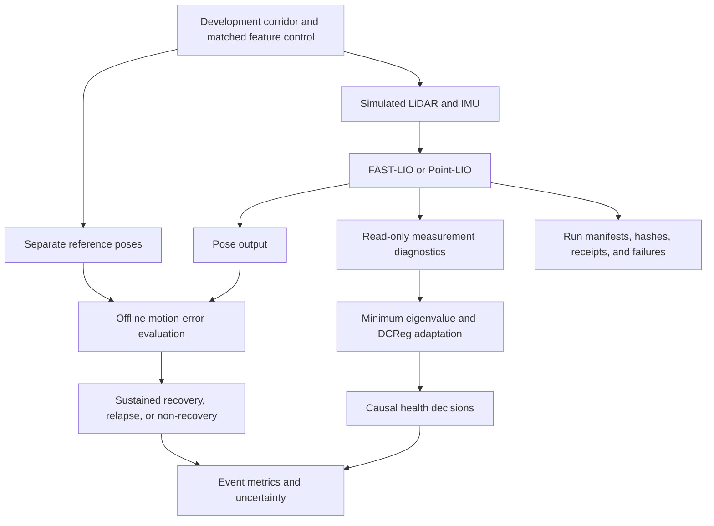

| Component | Implementation | What it establishes |
| --- | --- | --- |
| Controlled inputs | [Simulator](experiments/src/simulate_lidar.py), paired bag generation and scene/input audits | Randomized straight corridors, matched motion/control inputs, separately generated truth. |
| Primary estimator | Pinned FAST-LIO native build and [diagnostic patch](experiments/patches/fast_lio_health_diagnostic.patch) | Existing estimator with measurement-information export. |
| Replication estimator | Pinned Point-LIO with [read-only sidecar](experiments/patches/point_lio_indicator_sidecar.patch), [adapter](experiments/src/pointlio_information.py) and [exporter](experiments/src/pointlio_indicator_export.py) | Measurement rows transported into a common basis and pooled by frame; startup/reset/coverage rules. |
| Geometry signals | [FAST-LIO information calculation](experiments/src/fastlio_information.py), [DCReg Schur calculation](experiments/src/dcreg_schur.py) | Minimum eigenvalue at documented lever scales and a directional DCReg detector adaptation. This is not the full DCReg registration system. |
| Reference evaluation | [Trajectory evaluator](experiments/src/trajectory_eval.py) | Local translation/rotation errors and separately reported accumulated drift, without bridging reference gaps or resets. |
| Development analysis | [Accepted analysis](evidence/DEVELOPMENT_ANALYSIS_ACCEPTANCE_20261010.md) | Exhaustive raw-score candidate selection, backend-specific thresholds, event metrics and sample planning. |
| Final workflow | [R3 entry point](experiments/src/r3_evaluation_workflow.py), [Point-LIO runner](experiments/src/run_pointlio_final_replication.py), [statistics](experiments/src/heldout_statistics.py) | Gate checks, exact input identities, failure/cache handling and geometry-cluster uncertainty. Implementation is tested; final observations are still absent. |

## Development evidence

Each backend completed **32 corridor/control pairs: 64 formal scene runs**. FAST-LIO additionally has four declared repeats; 69 native attempts include a retained interruption and technical retry. Point-LIO reused two reviewed seed-14 slots and completed 62 new slots.

| Backend and diagnostic | Recovery detections | Initial false-healthy events¹ | Median delay among detections |
| --- | ---: | ---: | ---: |
| FAST-LIO minimum eigenvalue | 13/32 | 1/31 | 0.9003 s |
| FAST-LIO fixed DCReg adaptation | 30/32 | 0/31 | 4.0503 s |
| Point-LIO minimum eigenvalue | 21/27 | 3/32 | 3.2003 s |
| Point-LIO fixed DCReg adaptation | 20/27 | 11/32 | 1.7503 s |

¹ Conditional initial false-healthy denominators from the accepted development analysis. FAST-LIO has 32 recovered corridor events; Point-LIO has 27 recovered and five non-recovered events. Each has one relapse. Thus recovery-sensitivity denominators differ. Scalar thresholds were selected on these same development events, excluding controls. These counts are descriptive development evidence, with no demonstrated final-data superiority.

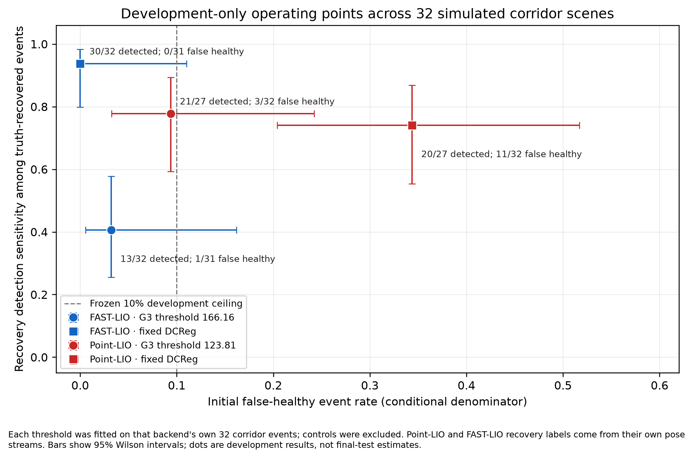

**How to read this figure:** moving left means fewer initial false-healthy events; moving up means more detected recoveries among events that actually recovered. Blue denotes FAST-LIO and red denotes Point-LIO; circles are the scalar diagnostic and squares are the fixed DCReg adaptation. Horizontal and vertical bars show event-level 95% Wilson intervals. The backend-specific recovery denominators differ, so this is not a direct estimator leaderboard.

The exact locked scalar thresholds are `166.16366016039856` for FAST-LIO and `123.80876977779258` for Point-LIO. The figure’s dashed 10% line is the development selection ceiling, not a demonstrated safety guarantee. Sources: [accepted analysis](evidence/DEVELOPMENT_ANALYSIS_ACCEPTANCE_20261010.md), [figure manifest](figures/development_signal_comparison_20261010/figure_manifest.json).

### Fresh primary repeatability: movement errors

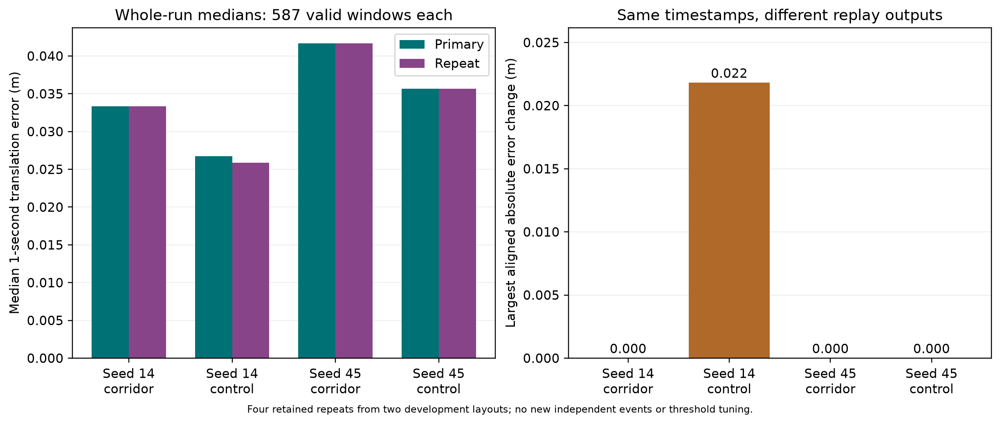

The left panel compares median one-second translation errors for primary and repeat executions of the same seed-14 and seed-45 inputs. Each comparison uses 587 jointly valid windows. The right panel shows the largest absolute error change at matching timestamps: a similar median can hide a local difference, such as the approximately 0.022 m seed-14 control change. Windows are correlated observations, not 587 independent scenes.

### Fresh primary repeatability: warning decisions

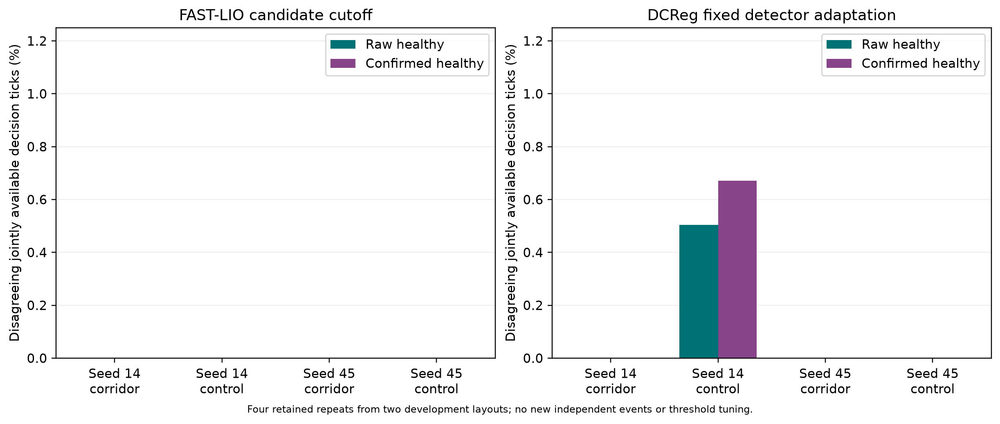

The panels compare FAST-LIO scalar and fixed DCReg warning states between primary and repeat runs. Teal shows disagreements before confirmation; purple shows disagreements after the consecutive-tick confirmation rule. A nonzero bar means the same input produced a different warning decision at some matching, jointly available ticks. It does not measure false-healthy events against truth; confirmation can alter disagreement rather than always reduce it.

Repeats measure execution variability; they do not add independent geometry events. See [fresh primary recovery](evidence/PRIMARY_DEVELOPMENT_RECOVERY_20261009.md) and its [repeat audit](evidence/primary_recovery_repeatability_20261009.json).

## Real-recording illustrations: Hilti-Oxford Exp18

These are supporting development illustrations from a handheld recording. They explain the sensor data and reference limitations; they do not establish real-world recovery.

### What the LiDAR saw before and after the scene change

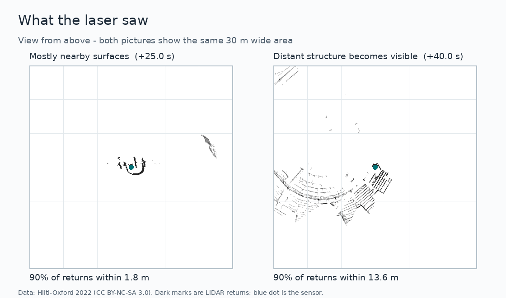

Both panels show the same 30 m-wide area centred on the sensor, marked by the blue dot. Dark marks represent LiDAR returns. At approximately 25 s, most returns are nearby; at approximately 40 s, more distant structure appears. The 90th-percentile range changes from about 1.8 m to 13.6 m. This supports a change in visible geometry, but cannot determine when the motion estimate recovered. Display filtering and source attribution are in the [figure guide](figures/README.md).

### Recording, reference coverage and replay duration

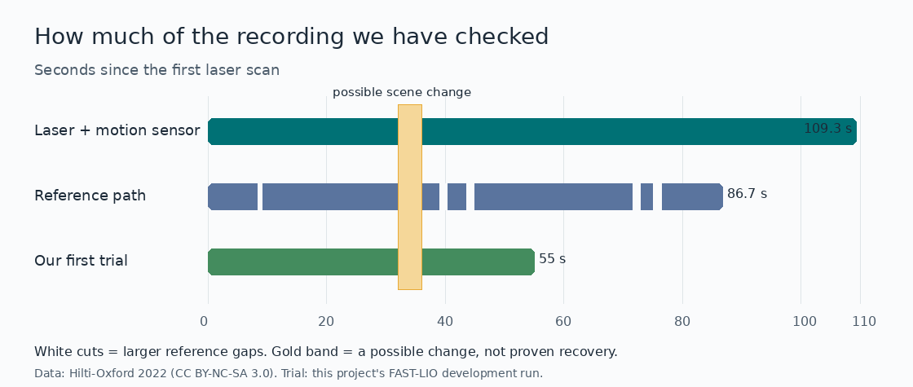

The top strip shows about 109.3 s of sensor recording; the middle strip shows the shorter 86.7 s reference span; the bottom strip shows the first 55 s replay. White cuts mark large reference gaps, where movement errors may be unavailable. The gold band is the early approximate scene-change annotation, not a recovery label. The later [event audit](data/HILTI_EXP18_EVENT.md) refined the exit interval to 31.6–33.6 s; this historical image retains the earlier coarse band.

### Geometry signal, local movement error and accumulated drift

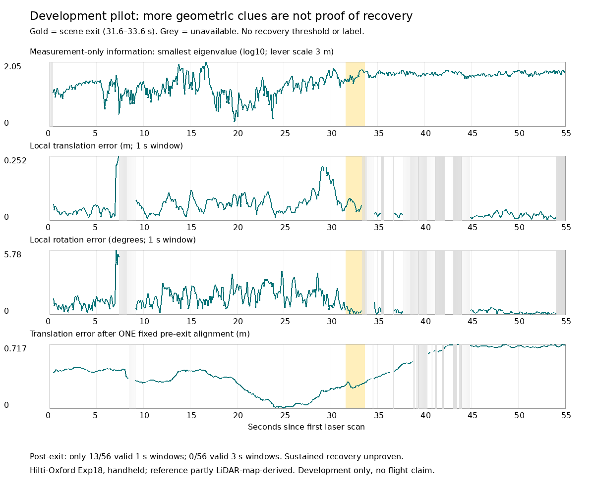

Read the four panels from top to bottom: logarithmic minimum information eigenvalue, one-second translation error in metres, one-second rotation error in degrees, and accumulated translation error after one fixed alignment. Gold marks the LiDAR-defined exit interval and grey marks unavailable observations. A stronger information signal is not itself proof of accurate movement, and accurate local movement would not erase accumulated drift.

Only 13/56 post-exit one-second windows and 0/56 three-second windows had usable reference in this pilot. The reference is partly LiDAR-map-derived, so sustained independent recovery remains unproven. Sources: [pilot report](evidence/HILTI_EXP18_T07_PILOT.md), [plot provenance](evidence/exp18_pilot_manifest.json).

## Historical simulation illustrations

These figures show how the simulation developed. Their single-seed outcomes are separate from the current 32-pair development analyses and the pending final evaluation.

### Forty-second motion-v3 corridor/control pilot

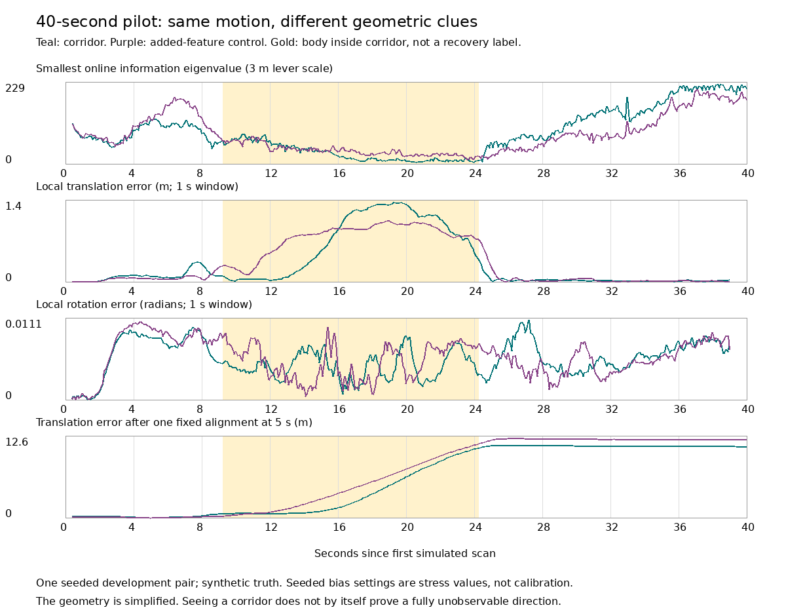

Teal denotes the corridor run and purple the added-feature control, using matched simulated movement and IMU inputs. Gold marks the body inside the corridor. The panels show the minimum information eigenvalue, one-second translation error, one-second rotation error in radians, and accumulated translation error after a fixed alignment at 5 s.

In this example, local translation errors decrease after exit while accumulated position errors remain large. This illustrates why local recovery and global drift are measured separately. It is one development pair under seeded bias stress settings, not calibrated real-sensor performance or a general recovery result. Source: [motion-v3 report](evidence/SIMULATION_MOTION_V3.md) and [manifest](evidence/simulation_motion_v3_manifest.json).

### Earlier simulation bootstrap

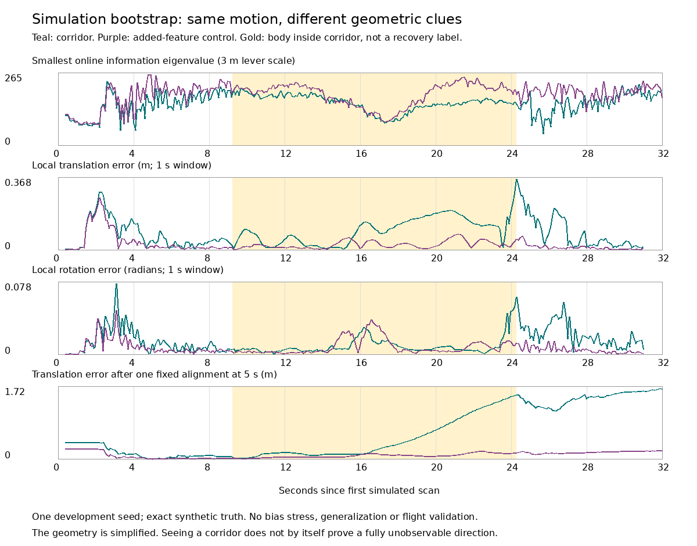

The same four-panel layout shows an earlier roughly 32-second feasibility run: geometric information, local translation error, local rotation error in radians, and accumulated translation error. Teal and purple distinguish corridor and feature-control runs; gold marks corridor occupancy. This version used one development seed without the later bias stress, and subsequent simulator versions supersede it. It demonstrates that sensor replay and offline truth comparison worked, rather than establishing generalization. Source: [bootstrap report](evidence/SIMULATION_BOOTSTRAP.md) and [manifest](evidence/simulation_bootstrap_manifest.json).

### Original retained repeats: movement errors

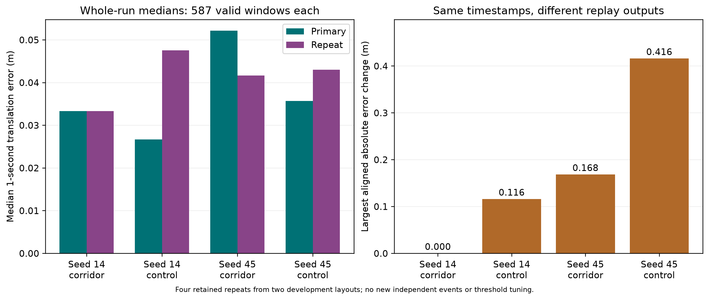

This original repeat audit compares median local translation errors on the left and the largest aligned error changes on the right. Several repeat trajectories differ despite identical inputs; the seed-45 control has a largest aligned change of about 0.416 m. These values belong to the historical cohort and must not be substituted for the fresh-repeat results above. Source: [original repeatability report](evidence/T14_REPEATABILITY_AUDIT.md).

### Original retained repeats: warning disagreements

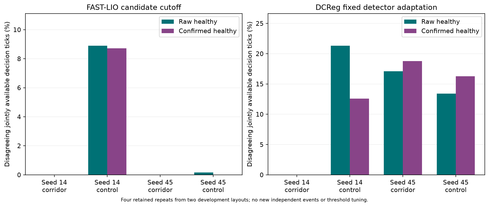

The bars show the percentage of 596 jointly available decision ticks where original primary and retained-repeat warning states disagree. Teal denotes raw states and purple confirmed states. The left panel uses the FAST-LIO candidate cutoff; the right uses the fixed DCReg adaptation. Differences demonstrate execution variability and its effect on decisions, not extra independent events or a false-healthy rate. This historical audit is superseded for current-cohort reporting by the fresh figures above. Export hashes and source identity: [original figure manifest](figures/t14_repeat_figure_manifest.json).

### Geometry screening repair: development candidate


The upper panels show the original four partial baffles and a proposed eight-baffle control in a 16.5 m long corridor. Orange marks baffles, black the walls, and dashed blue the open central route. The candidate bounds feature spacing at 2 m. The lower bars compare eligibility across 32 development fixtures per dimension group: long/narrow improves from 0 to 22; short/wide remains 18 because its failures involve shared corridor/post-exit geometry. The dashed orange line marks the planned final quota of 12. These are geometry checks, not estimator recovery results. The revision subsequently passed independent R2/R3 review and native development checks; its fresh final screen passed. Final estimator conclusions remain pending. [Repair report](execution/GEOMETRY_REPAIR_20261012.md), [audit](evidence/geometry_revision_development_20261012.json), [manifest](figures/geometry_revision_development_20261012/manifest.json).

Every research PNG currently retained under `figures/` is displayed above. PDF/SVG files are alternate exports of the same plots; their provenance is indexed in the [figure guide](figures/README.md). Archived landing-prototype figures under `../old_data/` belong to a separate study.

## What verification and tests cover

| Verification layer | Evidence | Limit |
| --- | --- | --- |
| Mathematical/unit checks | Information matrices, common-basis transport, Schur complements, relative transforms, quaternion interpolation | Checks calculations and invalid-input handling, not generalization. |
| Contract/regression tests | Timestamp association, gaps, startup/reset boundaries, frame coverage, pose joins and exact candidate selection | Checks behavior under fixtures. |
| Native development checks | Sidecar on/off pose identity, measurement coverage, compiled reset fixture in earlier bounded verification, accepted replay cohorts | Native evidence is separate from mocked runner tests. |
| Provenance and lifecycle | Source/config/output hashes, atomic recording, preserved failures, completed replay reuse, diagnosed retry limits | Checks identity and execution accounting. |
| Independent reviews | R1 protocol feasibility, R2 protocol/amendment acceptance, Point-LIO development/freeze acceptance, R3 implementation PASS | Scoped acceptance does not establish publication novelty. |
| Final statistics fixtures | Stratified geometry bootstrap, event weighting, incomplete-cohort handling, literal RNG reference tests | Final analysis software is checked; no final dataset estimate exists. |

**Fresh audit run:** 233 tests discovered; **231 passed, 2 skipped**, zero failures, in the frozen Python 3.12.14 environment. The skipped checks were the SciPy scene-structure fixture and the native C++ sidecar fixture requiring `POINTLIO_SOURCE_ROOT`. The latter has historical compiled verification; it was not executed in this audit. Details: [audit](execution/RESEARCH_DOCUMENTATION_AUDIT_20261012.md).

**Later geometry-repair check:** 238 tests, **236 passed, 2 skipped**, including five new geometry tests. [Test log](evidence/geometry_revision_tests_20261012.log). These were initial candidate checks. Later integration and native checks passed **244 tests: 243 passed, one optional SciPy skip**, including the compiled reset fixture; see [revised native evidence](evidence/GEOMETRY_V2_NATIVE_VALIDATION_20261012.md).

## Read and verify locally

Start with the linked [revised R3 decision](reviews/R3_GEOMETRY_V2_IMPLEMENTATION_20261012.md), [freeze](protocol/IMPLEMENTATION_FREEZE_GEOMETRY_V2_20261012.md) and [corrected development report](evidence/DEVELOPMENT_ANALYSIS_ACCEPTANCE_20261010.md). Small evidence and figures are retained in Git; native builds, sensor bags and bulk streams require the external research workspace. A clone alone cannot reproduce native runs.

On the current Linux host, from the repository root:

```bash
RESEARCH_PY='/run/media/harshil/Acer/GPS-Denied-Drone-Research/Hilti-Oxford-Exp18/ros_env/bin/python'
"$RESEARCH_PY" -m unittest discover -s research_paper/experiments/tests -v
```

Read-only freeze verification, without generating or opening held-out inputs:

```bash
PYTHONPATH=research_paper/experiments/src "$RESEARCH_PY" - <<'PY'
from pathlib import Path
import r3_evaluation_workflow as workflow
root = Path.cwd()
gate = workflow.require_r3_pass(
    root / 'research_paper/reviews/R3_GEOMETRY_V2_IMPLEMENTATION_20261012.md',
    root / 'research_paper/protocol/IMPLEMENTATION_FREEZE_GEOMETRY_V2_20261012.md')
print('PASS:', len(gate['reviewed_artifact_hashes']), 'inventory entries')
PY
```

Other hosts need the recorded isolated dependencies and path restoration; see [environment](execution/ENVIRONMENT.md). [Experiment README](experiments/README.md) retains GEODE setup history; its old headline counts are not the latest checkpoint. Final execution instructions are in [the final handoff](execution/FINAL_EVALUATION_HANDOFF.md); follow the frozen gate and protocol before running them.

## Existing illustrations and missing figures

| Research step | Visual coverage | What to add |
| --- | --- | --- |
| Real-data inspection/reference limits | Hilti scan snapshots, coverage timeline and pilot plot exist | Keep supporting-data labels and explain the historical approximate exit band. |
| Early simulation | Bootstrap and motion-v3 timelines exist | Add a dimensioned formal corridor/control schematic with sensor and body axes. |
| Current development comparison | Two-backend operating-point figure with intervals exists | Link the current figure, rather than historical FAST-LIO-only counts. |
| Fresh repeatability | Motion and warning disagreement plots exist | Keep repeat IDs and no-new-event caption. |
| Recovery definition and online timing | Written rules; no dedicated timing diagram | Show exit, causal decision ticks, three truth windows, confirmation, delay and relapse. |
| Current event failures/availability | Tables/manifests; no complete visual ledger | Add all-event outcome tiles including non-recovery, unavailable and failed attempts. |
| Split and review path | Manifests/reviews; partial workflow diagrams | Add a split diagram and dated checkpoint table. |
| Final results | Absent because final evaluation is pending | After execution, add per-stratum event estimates, delays, availability, paired effects and cluster intervals. |

The [visual documentation plan](execution/RESEARCH_DOCUMENTATION_AUDIT_20261012.md) specifies sources, placement, plotting rules and reproduction requirements for each addition. [Figure guide](figures/README.md) records existing figure provenance.

## Is the research complete, and is it novel?

**No final research conclusion is established yet.** The software milestone is accepted; the scientific evaluation and manuscript remain open.

The closest recent overlap is Zhang et al., [OCE: an optimization convergence metric for LiDAR SLAM degeneracy detection](https://link.springer.com/article/10.1007/s43684-026-00144-1), published 9 October 2026. Its Section 4.2, Eqs. 12–13 and Tables 1/3 already examine ground-truth local-motion usability, detection errors, hysteresis and recovery delay. Those concepts alone cannot establish this project's novelty.

The remaining candidate contribution is **external transfer across straight-corridor length/width strata, with sustained joint translation/rotation outcomes and independently instrumented FAST-LIO/Point-LIO replication**. The failed screen exposed geometry from those strata; the proposed revised cohort uses fresh instances but must disclose design adaptation to that screen. This is a useful evaluation question; distinct sample size or two backends alone do not prove novelty. The [OCE review](reviews/OCE_NOVELTY_FEASIBILITY_20261010.md) passes feasibility only and predates the failed screen. OCE is not implemented here, so no superiority claim against OCE is justified.

Remaining completion steps:

1. Geometry amendment, revised R3 freeze and fresh 48-pair screen are accepted. Execute the frozen two-backend native cohort, preserving every attempt and failure; follow the [current ledger](execution/GEOMETRY_V2_EXECUTION_20261012.md).
2. Run FAST-LIO and Point-LIO on the same accepted sensor inputs without retuning.
3. Analyze frozen endpoints, uncertainty, availability, delay, relapse and non-recovery, preserving all planned denominators.
4. Assess the resulting finding against the closest literature; report transfer success or failure honestly.
5. Complete and review the manuscript, figures, reproducibility package and limitations. [Main manuscript](paper/main.tex) remains a proposal abstract; [methods draft](paper/methods_protocol_draft.tex) is preliminary.

Controlled simulation supplies primary quantitative reference. Hilti Exp18 is supporting evidence: only 13/56 post-exit one-second windows and 0/56 three-second windows were scoreable in the pilot, and its reference is partly LiDAR-registration-derived. GEODE failures remain in the historical record. Neither supports a real-world recovery or flight-safety conclusion.

## Repository map

| Directory | Contents |
| --- | --- |
| `literature/` | Closest-work notes, comparisons and dated overlap addenda |
| `data/`, `protocol/`, `configs/` | Eligibility, frozen splits/outcomes, frame contracts and backend configurations |
| `experiments/src/`, `experiments/tests/`, `experiments/patches/` | Simulation, diagnostics, evaluation, workflow tests and native instrumentation |
| `evidence/`, `reviews/` | Small manifests, accepted analyses, retained failures and independent gate reports |
| `figures/`, `paper/` | Provenance-backed plots, proposal manuscript and methods draft |
| `execution/` | Handoffs, plans, decision history and this audit |
| `../old_data/` | Archived safe-landing prototype; separate historical evidence |

Hilti illustration credit: [Hilti-Oxford 2022 dataset](https://hilti-challenge.com/dataset-2022), [CC BY-NC-SA 3.0](https://creativecommons.org/licenses/by-nc-sa/3.0/). This study is separate from VERGE-CUAS.
