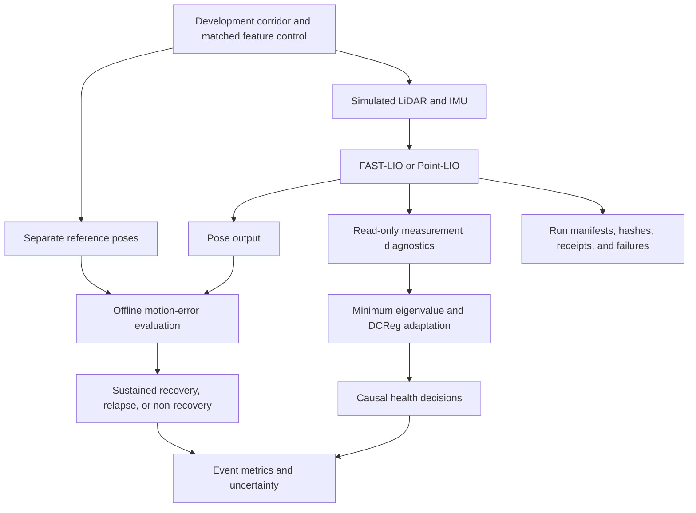
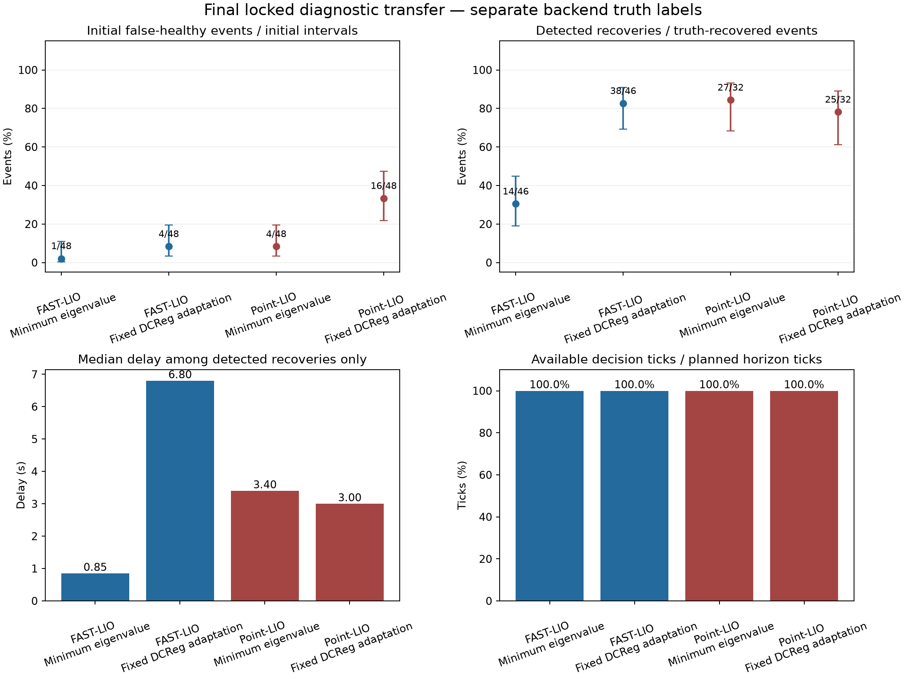
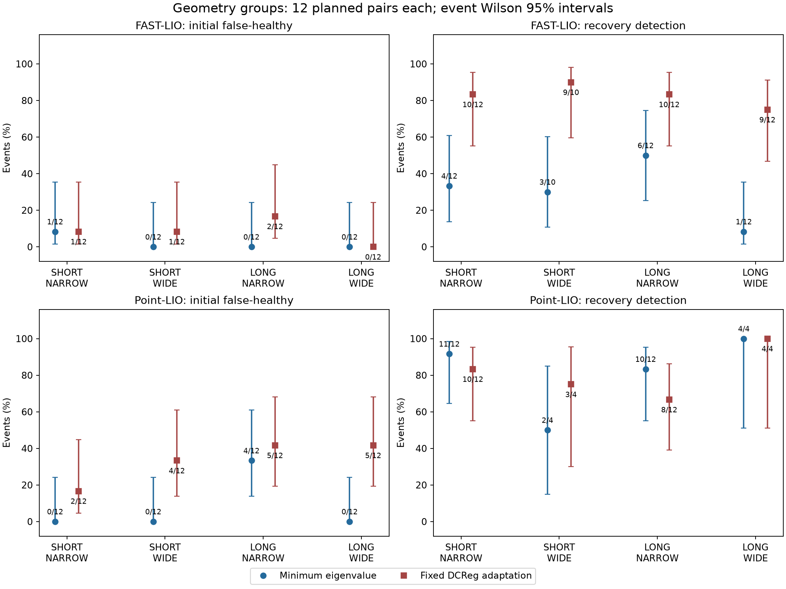
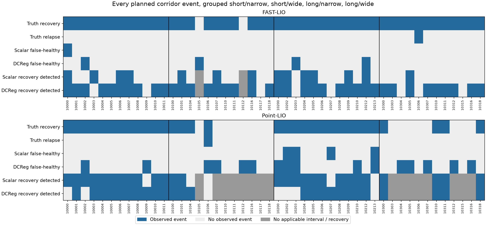
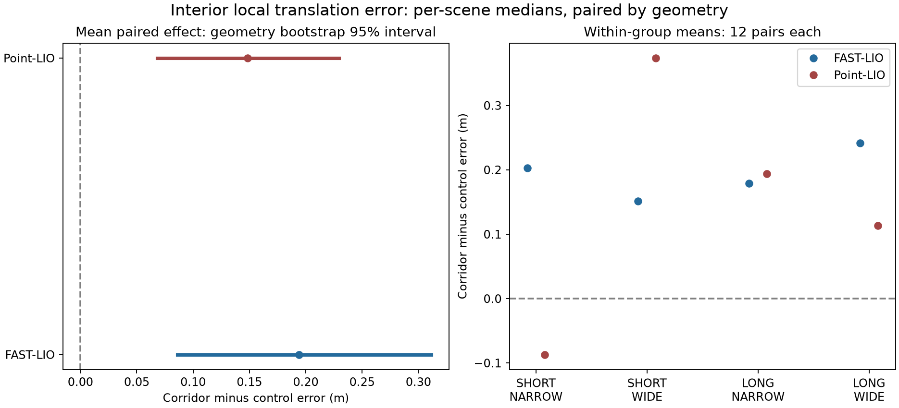
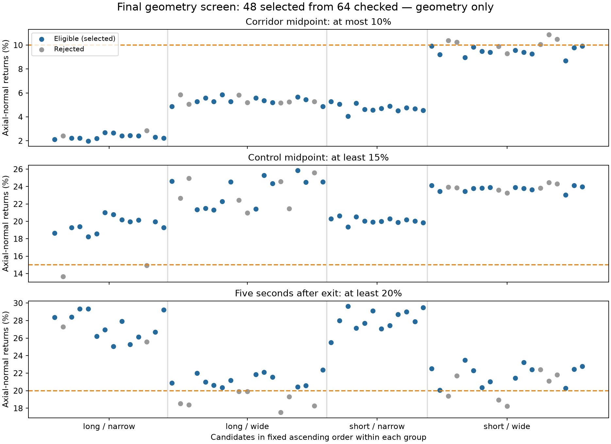

# Assessing recovery reliability in LiDAR-inertial odometry

**Authors:** Harshil Patel, Daksha Lingampeta, Nisarg Vyas

**Verified checkpoint: 12 October 2026 — controlled two-backend evaluation complete; manuscript and publication novelty unfinished.**

**Revised checkpoint:** the [R2 geometry amendment](reviews/R2_GEOMETRY_AMENDMENT_20261012.md), [revised R3 review](reviews/R3_GEOMETRY_V2_IMPLEMENTATION_20261012.md) and [197-entry freeze](protocol/IMPLEMENTATION_FREEZE_GEOMETRY_V2_20261012.md) passed. The geometry screen selected **48 pairs, 12 per group**, after 64 candidate checks. FAST-LIO and Point-LIO each completed **96 native runs on identical sensor inputs**. Both analyses returned `CONFIRMATORY_COMPLETE`. A metadata-only analysis adapter passed [supplemental independent review](reviews/R3_GEOMETRY_V2_ANALYSIS_COMPATIBILITY_20261012.md); original frozen scientific files remain intact. [Results and limitations](evidence/final_geometry_v2_results_20261012/RESULTS_REPORT.md), [execution ledger](execution/GEOMETRY_V2_EXECUTION_20261012.md).

After a robot leaves a corridor with weak geometric clues, can its existing LiDAR health signals tell when its **new motion estimates** are accurate again? This study evaluates existing FAST-LIO and Point-LIO diagnostics against reference-defined recovery. It builds an evaluation workflow, rather than a new odometry estimator.

Both backends completed the historical development cohort, revised-control native checks and fresh final evaluation. **Final experimental results now exist; publication novelty and the manuscript remain unfinished.** Original IDs 100–179 were excluded after the failed screen; fresh instances do not erase design adaptation to that screen. No flight or deployment safety claim is supported.

This is the current research README. The repository-root README and several execution summaries retain older checkpoints and are bound into the accepted freeze. This document supplements them without modifying those hashes. See the [documentation audit](execution/RESEARCH_DOCUMENTATION_AUDIT_20261012.md) for conflicts and missing visuals.

## What “recovery” means

More useful geometry, accurate new movement, and corrected total position are three separate things. Better scan matching after a corridor can improve the next step while leaving earlier position drift in place.

The primary outcome requires three consecutive non-overlapping one-second motion windows, each within **0.20 m translation error and 5° rotation error**, confirmed within 20 seconds after the predefined exit. These are research tolerances. Reference poses are used only offline; the health decision uses causal information on a 10 Hz grid with three-tick confirmation. Missing reference, startup data, and resets remain explicitly unavailable.

Definitions and edge cases: [metrics](protocol/METRICS.md), [data contract](protocol/DATA_CONTRACT.md), [simulation](protocol/SIMULATION.md).

## Implemented workflow



| Component | Implementation | What it establishes |
| --- | --- | --- |
| Controlled inputs | [Simulator](experiments/src/simulate_lidar.py), paired bag generation and scene/input audits | Randomized straight corridors, matched motion/control inputs, separately generated truth. |
| Primary estimator | Pinned FAST-LIO native build and [diagnostic patch](experiments/patches/fast_lio_health_diagnostic.patch) | Existing estimator with measurement-information export. |
| Replication estimator | Pinned Point-LIO with [read-only sidecar](experiments/patches/point_lio_indicator_sidecar.patch), [adapter](experiments/src/pointlio_information.py) and [exporter](experiments/src/pointlio_indicator_export.py) | Measurement rows transported into a common basis and pooled by frame; startup/reset/coverage rules. |
| Geometry signals | [FAST-LIO information calculation](experiments/src/fastlio_information.py), [DCReg Schur calculation](experiments/src/dcreg_schur.py) | Minimum eigenvalue at documented lever scales and a directional DCReg detector adaptation. This is not the full DCReg registration system. |
| Reference evaluation | [Trajectory evaluator](experiments/src/trajectory_eval.py) | Local translation/rotation errors and separately reported accumulated drift, without bridging reference gaps or resets. |
| Development analysis | [Accepted analysis](evidence/DEVELOPMENT_ANALYSIS_ACCEPTANCE_20261010.md) | Exhaustive raw-score candidate selection, backend-specific thresholds, event metrics and sample planning. |
| Final workflow | [R3 entry point](experiments/src/r3_evaluation_workflow.py), [Point-LIO runner](experiments/src/run_pointlio_final_replication.py), [statistics](experiments/src/heldout_statistics.py) | Gate checks, exact input identities, failure/cache handling and geometry-cluster uncertainty. Both 48-pair native cohorts and analyses are complete; outcomes and limitations are reported below. |

## Final revised geometry results

The final dataset contains 48 corridor/control pairs in four groups. Both backends used the same sensor-bag hashes and fixed development-selected cutoffs. There were **192 completed native scene runs, zero native replay failures**. The retained Point-LIO preflight failure and original FAST analysis rejection required operational/metadata fixes; both are preserved in the [result report](evidence/final_geometry_v2_results_20261012/RESULTS_REPORT.md).

| Backend and diagnostic | Detected / truth-recovered | Initial false-healthy, conditional | Initial false-healthy, unconditional | Median delay, detected only |
| --- | ---: | ---: | ---: | ---: |
| FAST-LIO minimum eigenvalue | 14/46 | 1/46 | 1/48 | 0.850 s |
| FAST-LIO fixed DCReg adaptation | 38/46 | 4/46 | 4/48 | 6.800 s |
| Point-LIO minimum eigenvalue | 27/32 | 4/47 | 4/48 | 3.400 s |
| Point-LIO fixed DCReg adaptation | 25/32 | 16/47 | 16/48 | 3.000 s |

FAST-LIO recovered in **46/48** corridor events, with two non-recoveries; Point-LIO recovered in **32/48**, with 16 non-recoveries. Each backend has one relapse. All four diagnostics have 9,600/9,600 available decision ticks in the primary post-exit horizon. Conditional false-healthy denominators require a decision tick inside the initial unrecovered interval; extremely short intervals explain why those denominators differ despite full overall horizon availability. Non-recoveries remain censored at the 20 s deadline, and missed detections receive no invented delay.

### Locked operating points, delay and availability



The upper-left panel shows **unconditional** initial false-healthy rates; the upper-right shows detection among actual recoveries. Bars are event-level 95% Wilson intervals. Blue is FAST-LIO and red is Point-LIO. The lower-left compares median delays among detections only: FAST scalar's short delay accompanies 32 missed recoveries, so it is not evidence of better overall responsiveness. The lower-right shows available/planned ticks, not correctness or flight safety. The backend recovery denominators differ because labels come from each backend's own poses.

The scalar conditional false-healthy point estimates are below 10%, but their 95% upper bounds reach **11.3% for FAST-LIO and 19.9% for Point-LIO**. The final sample does not prove a population guarantee below 10%. Point-LIO fixed DCReg has 16/47 initial false-healthy events (34.0%); fixed rules do not transfer uniformly.

### Results by geometry group



Each group contains 12 planned geometries. Blue circles are the scalar diagnostic; red squares are fixed DCReg. The left column shows unconditional false-healthy events, the right detection among truth-recovered events; vertical bars are 95% Wilson intervals. Point-LIO recovered in all 24 narrow corridors but only 8/24 wide corridors. Its four scalar false-healthy events all occur in long/narrow (4/12). FAST scalar detects only 1/12 long/wide recoveries. These group-specific observations show why pooled rates are insufficient; the small group samples give wide uncertainty.

### Every planned corridor event



Each column is a selected seed, with 12 columns per geometry group. The rows show reference-defined recovery and relapse, then scalar/DCReg false-healthy events and recovery detections. Blue means the named event occurred: a blue recovery cell and a blue false-healthy cell have different implications. White means no event was observed; grey marks an inapplicable interval or recovery-detection endpoint. All non-recoveries remain visible. These are 48 shared geometries, not independent samples for every coloured cell. Point fixed DCReg has a post-relapse false-healthy event in the single relapsed corridor; the other methods have zero out of one. One relapse per backend is insufficient for a broad relapse-reliability claim.

### Paired interior error and geometry uncertainty



For each pair, the analysis subtracts the control's median interior one-second translation error from the corridor's median error. The left panel shows the equal-group mean difference and its 95% interval from 10,000 paired geometry resamples within fixed groups: **FAST-LIO +0.194 m [0.086, 0.311]; Point-LIO +0.149 m [0.068, 0.230]**. Positive values mean larger corridor error. The right panel shows group means without group confidence intervals. Point short/narrow has a negative mean, so the positive aggregate does not demonstrate uniform control benefit in every group. These are local movement errors; they do not establish correction of old global drift or a between-estimator superiority test.

Exact numerical values, event-weighted ROC/AP, tolerance/window sensitivity analyses and all failures are retained in the [full result report](evidence/final_geometry_v2_results_20261012/RESULTS_REPORT.md), [analysis exports](evidence/final_geometry_v2_results_20261012/export_audit.json), [event CSV](evidence/final_geometry_v2_results_20261012/corridor_event_ledger.csv) and [figure manifest](figures/final_geometry_v2_results_20261012/manifest.json). No final threshold fitting or geometry replacement occurred.

## Development evidence

Each backend completed **32 corridor/control pairs: 64 formal scene runs**. FAST-LIO additionally has four declared repeats; 69 native attempts include a retained interruption and technical retry. Point-LIO reused two reviewed seed-14 slots and completed 62 new slots.

| Backend and diagnostic | Recovery detections | Initial false-healthy events¹ | Median delay among detections |
| --- | ---: | ---: | ---: |
| FAST-LIO minimum eigenvalue | 13/32 | 1/31 | 0.9003 s |
| FAST-LIO fixed DCReg adaptation | 30/32 | 0/31 | 4.0503 s |
| Point-LIO minimum eigenvalue | 21/27 | 3/32 | 3.2003 s |
| Point-LIO fixed DCReg adaptation | 20/27 | 11/32 | 1.7503 s |

¹ Conditional initial false-healthy denominators from the accepted development analysis. FAST-LIO has 32 recovered corridor events; Point-LIO has 27 recovered and five non-recovered events. Each has one relapse. Thus recovery-sensitivity denominators differ. Scalar thresholds were selected on these same development events, excluding controls. These counts are descriptive development evidence, with no demonstrated final-data superiority.


**How to read this figure:** moving left means fewer initial false-healthy events; moving up means more detected recoveries among events that actually recovered. Blue denotes FAST-LIO and red denotes Point-LIO; circles are the scalar diagnostic and squares are the fixed DCReg adaptation. Horizontal and vertical bars show event-level 95% Wilson intervals. The backend-specific recovery denominators differ, so this is not a direct estimator leaderboard.

The exact locked scalar thresholds are `166.16366016039856` for FAST-LIO and `123.80876977779258` for Point-LIO. The figure’s dashed 10% line is the development selection ceiling, not a demonstrated safety guarantee. Sources: [accepted analysis](evidence/DEVELOPMENT_ANALYSIS_ACCEPTANCE_20261010.md), [figure manifest](figures/development_signal_comparison_20261010/figure_manifest.json).

### Fresh primary repeatability: movement errors


The left panel compares median one-second translation errors for primary and repeat executions of the same seed-14 and seed-45 inputs. Each comparison uses 587 jointly valid windows. The right panel shows the largest absolute error change at matching timestamps: a similar median can hide a local difference, such as the approximately 0.022 m seed-14 control change. Windows are correlated observations, not 587 independent scenes.

### Fresh primary repeatability: warning decisions


The panels compare FAST-LIO scalar and fixed DCReg warning states between primary and repeat runs. Teal shows disagreements before confirmation; purple shows disagreements after the consecutive-tick confirmation rule. A nonzero bar means the same input produced a different warning decision at some matching, jointly available ticks. It does not measure false-healthy events against truth; confirmation can alter disagreement rather than always reduce it.

Repeats measure execution variability; they do not add independent geometry events. See [fresh primary recovery](evidence/PRIMARY_DEVELOPMENT_RECOVERY_20261009.md) and its [repeat audit](evidence/primary_recovery_repeatability_20261009.json).

## Real-recording illustrations: Hilti-Oxford Exp18

These are supporting development illustrations from a handheld recording. They explain the sensor data and reference limitations; they do not establish real-world recovery.

### What the LiDAR saw before and after the scene change


Both panels show the same 30 m-wide area centred on the sensor, marked by the blue dot. Dark marks represent LiDAR returns. At approximately 25 s, most returns are nearby; at approximately 40 s, more distant structure appears. The 90th-percentile range changes from about 1.8 m to 13.6 m. This supports a change in visible geometry, but cannot determine when the motion estimate recovered. Display filtering and source attribution are in the [figure guide](figures/README.md).

### Recording, reference coverage and replay duration


The top strip shows about 109.3 s of sensor recording; the middle strip shows the shorter 86.7 s reference span; the bottom strip shows the first 55 s replay. White cuts mark large reference gaps, where movement errors may be unavailable. The gold band is the early approximate scene-change annotation, not a recovery label. The later [event audit](data/HILTI_EXP18_EVENT.md) refined the exit interval to 31.6–33.6 s; this historical image retains the earlier coarse band.

### Geometry signal, local movement error and accumulated drift


Read the four panels from top to bottom: logarithmic minimum information eigenvalue, one-second translation error in metres, one-second rotation error in degrees, and accumulated translation error after one fixed alignment. Gold marks the LiDAR-defined exit interval and grey marks unavailable observations. A stronger information signal is not itself proof of accurate movement, and accurate local movement would not erase accumulated drift.

Only 13/56 post-exit one-second windows and 0/56 three-second windows had usable reference in this pilot. The reference is partly LiDAR-map-derived, so sustained independent recovery remains unproven. Sources: [pilot report](evidence/HILTI_EXP18_T07_PILOT.md), [plot provenance](evidence/exp18_pilot_manifest.json).

## Historical simulation illustrations

These figures show how the simulation developed. Their single-seed outcomes are separate from the current 32-pair development analyses and the separate completed final evaluation.

### Forty-second motion-v3 corridor/control pilot


Teal denotes the corridor run and purple the added-feature control, using matched simulated movement and IMU inputs. Gold marks the body inside the corridor. The panels show the minimum information eigenvalue, one-second translation error, one-second rotation error in radians, and accumulated translation error after a fixed alignment at 5 s.

In this example, local translation errors decrease after exit while accumulated position errors remain large. This illustrates why local recovery and global drift are measured separately. It is one development pair under seeded bias stress settings, not calibrated real-sensor performance or a general recovery result. Source: [motion-v3 report](evidence/SIMULATION_MOTION_V3.md) and [manifest](evidence/simulation_motion_v3_manifest.json).

### Earlier simulation bootstrap


The same four-panel layout shows an earlier roughly 32-second feasibility run: geometric information, local translation error, local rotation error in radians, and accumulated translation error. Teal and purple distinguish corridor and feature-control runs; gold marks corridor occupancy. This version used one development seed without the later bias stress, and subsequent simulator versions supersede it. It demonstrates that sensor replay and offline truth comparison worked, rather than establishing generalization. Source: [bootstrap report](evidence/SIMULATION_BOOTSTRAP.md) and [manifest](evidence/simulation_bootstrap_manifest.json).

### Original retained repeats: movement errors


This original repeat audit compares median local translation errors on the left and the largest aligned error changes on the right. Several repeat trajectories differ despite identical inputs; the seed-45 control has a largest aligned change of about 0.416 m. These values belong to the historical cohort and must not be substituted for the fresh-repeat results above. Source: [original repeatability report](evidence/T14_REPEATABILITY_AUDIT.md).

### Original retained repeats: warning disagreements


The bars show the percentage of 596 jointly available decision ticks where original primary and retained-repeat warning states disagree. Teal denotes raw states and purple confirmed states. The left panel uses the FAST-LIO candidate cutoff; the right uses the fixed DCReg adaptation. Differences demonstrate execution variability and its effect on decisions, not extra independent events or a false-healthy rate. This historical audit is superseded for current-cohort reporting by the fresh figures above. Export hashes and source identity: [original figure manifest](figures/t14_repeat_figure_manifest.json).

### Geometry screening repair: development candidate


The upper panels show the original four partial baffles and a proposed eight-baffle control in a 16.5 m long corridor. Orange marks baffles, black the walls, and dashed blue the open central route. The candidate bounds feature spacing at 2 m. The lower bars compare eligibility across 32 development fixtures per dimension group: long/narrow improves from 0 to 22; short/wide remains 18 because its failures involve shared corridor/post-exit geometry. The dashed orange line marks the planned final quota of 12. These are geometry checks, not estimator recovery results. The revision subsequently passed independent R2/R3 review and native development checks; its fresh final screen passed. Final estimator findings are reported separately above. [Repair report](execution/GEOMETRY_REPAIR_20261012.md), [audit](evidence/geometry_revision_development_20261012.json), [manifest](figures/geometry_revision_development_20261012/manifest.json).

### Accepted fresh geometry screen



Each dot is one of the 64 screened candidate layouts. Blue candidates passed all three criteria and were selected; grey candidates failed at least one criterion, even when they pass another panel. The top panel requires no more than 10% axial-normal returns in the corridor, the middle at least 15% in the matched control, and the bottom at least 20% five seconds after exit. Orange dashed lines show these fixed criteria. Vertical lines separate the four groups; candidates remain in ascending seed order within each group. The screen selected 48 pairs, 12 per group, before estimator execution. This figure documents geometry eligibility, not odometry accuracy or recovery. [Screen snapshot](evidence/final_geometry_screen_v2_20261012.json), [figure manifest](figures/final_geometry_screen_v2_20261012/manifest.json).

Every research PNG currently retained under `figures/` is displayed above. PDF/SVG files are alternate exports of the same plots; their provenance is indexed in the [figure guide](figures/README.md). Archived landing-prototype figures under `../old_data/` belong to a separate study.

## What verification and tests cover

| Verification layer | Evidence | Limit |
| --- | --- | --- |
| Mathematical/unit checks | Information matrices, common-basis transport, Schur complements, relative transforms, quaternion interpolation | Checks calculations and invalid-input handling, not generalization. |
| Contract/regression tests | Timestamp association, gaps, startup/reset boundaries, frame coverage, pose joins and exact candidate selection | Checks behavior under fixtures. |
| Native development checks | Sidecar on/off pose identity, measurement coverage, compiled reset fixture in earlier bounded verification, accepted replay cohorts | Native evidence is separate from mocked runner tests. |
| Provenance and lifecycle | Source/config/output hashes, atomic recording, preserved failures, completed replay reuse, diagnosed retry limits | Checks identity and execution accounting. |
| Independent reviews | R1 protocol feasibility, R2 protocol/amendment acceptance, Point-LIO development/freeze acceptance, R3 implementation PASS | Scoped acceptance does not establish publication novelty. |
| Final statistics fixtures | Stratified geometry bootstrap, event weighting, incomplete-cohort handling, literal RNG reference tests | Software checks are separate from the completed final estimates and their geometry uncertainty. |

**Fresh audit run:** 233 tests discovered; **231 passed, 2 skipped**, zero failures, in the frozen Python 3.12.14 environment. The skipped checks were the SciPy scene-structure fixture and the native C++ sidecar fixture requiring `POINTLIO_SOURCE_ROOT`. The latter has historical compiled verification; it was not executed in this audit. Details: [audit](execution/RESEARCH_DOCUMENTATION_AUDIT_20261012.md).

**Later geometry-repair check:** 238 tests, **236 passed, 2 skipped**, including five new geometry tests. [Test log](evidence/geometry_revision_tests_20261012.log). These were initial candidate checks. Later integration and native checks passed **244 tests: 243 passed, one optional SciPy skip**, including the compiled reset fixture; see [revised native evidence](evidence/GEOMETRY_V2_NATIVE_VALIDATION_20261012.md).

**Analysis compatibility supplement:** five focused tests verify that only validated secondary-threshold metadata is removed from the primary identity expectation, that all original checks are delegated, and that failures remain failures. Full regression: **249 tests, 248 passed, one optional SciPy skip**, with the native reset fixture enabled. [Review](reviews/R3_GEOMETRY_V2_ANALYSIS_COMPATIBILITY_20261012.md), [test log](evidence/geometry_v2_analysis_compat_regression_20261012.log). The retained Point-LIO preflight and original analysis failure are described in the [execution ledger](execution/GEOMETRY_V2_EXECUTION_20261012.md).

## Read and verify locally

Start with the linked [revised R3 decision](reviews/R3_GEOMETRY_V2_IMPLEMENTATION_20261012.md), [freeze](protocol/IMPLEMENTATION_FREEZE_GEOMETRY_V2_20261012.md) and [corrected development report](evidence/DEVELOPMENT_ANALYSIS_ACCEPTANCE_20261010.md). Small evidence and figures are retained in Git; native builds, sensor bags and bulk streams require the external research workspace. A clone alone cannot reproduce native runs.

On the current Linux host, from the repository root:

```bash
RESEARCH_PY='/run/media/harshil/Acer/GPS-Denied-Drone-Research/Hilti-Oxford-Exp18/ros_env/bin/python'
RESEARCH_BASE='/run/media/harshil/Acer/GPS-Denied-Drone-Research/Hilti-Oxford-Exp18'
export POINTLIO_SOURCE_ROOT="$RESEARCH_BASE/point_lio_ws_r2_20260929/src/point_lio"
export POINTLIO_EIGEN_INCLUDE="$RESEARCH_BASE/ros_env/include/eigen3"
"$RESEARCH_PY" -m unittest discover -s research_paper/experiments/tests -v
```

Read-only freeze verification, without generating or opening held-out inputs:

```bash
PYTHONPATH=research_paper/experiments/src "$RESEARCH_PY" - <<'PY'
from pathlib import Path
import r3_evaluation_workflow as workflow
root = Path.cwd()
gate = workflow.require_r3_pass(
    root / 'research_paper/reviews/R3_GEOMETRY_V2_IMPLEMENTATION_20261012.md',
    root / 'research_paper/protocol/IMPLEMENTATION_FREEZE_GEOMETRY_V2_20261012.md')
print('PASS:', len(gate['reviewed_artifact_hashes']), 'inventory entries')
PY
```

Other hosts need the recorded isolated dependencies and path restoration; see [environment](execution/ENVIRONMENT.md). [Experiment README](experiments/README.md) retains GEODE setup history; its old headline counts are not the latest checkpoint. The [dated execution ledger](execution/GEOMETRY_V2_EXECUTION_20261012.md) and [independent final audit](reviews/FINAL_GEOMETRY_V2_RESULT_AUDIT_20261012.md) describe the completed run. The older [final handoff](execution/FINAL_EVALUATION_HANDOFF.md) remains frozen checkpoint history. Point-LIO requires its scratch directory to exist before preflight; the initial missing-directory failure and fresh-root retry are retained.

Exact executed analysis commands, flags, paths and exit codes are preserved in [analysis resume state](evidence/final_geometry_v2_results_20261012/analysis_resume_state.json). FAST uses the separately reviewed metadata adapter; Point uses the unchanged `pointlio_final_analysis.py`. Reproduction must use fresh output paths and the accepted gates. To recreate compact exports and figures from the completed external results, use new output directories:

```bash
FINAL_ROOT="$RESEARCH_BASE/final_heldout_geometry_v2_20261012"
"$RESEARCH_PY" research_paper/experiments/src/export_final_geometry_results.py \
  --root "$FINAL_ROOT" --output /tmp/geometry-v2-export-reproduction
"$RESEARCH_PY" research_paper/experiments/src/plot_final_recovery_results.py \
  --fast-analysis research_paper/evidence/final_geometry_v2_results_20261012/fastlio_analysis.json \
  --point-analysis research_paper/evidence/final_geometry_v2_results_20261012/pointlio_analysis.json \
  --output /tmp/geometry-v2-figure-reproduction
```

[Report generator](experiments/src/write_final_geometry_report.py) recreates the checked-in CSV/report files from the exported analyses when run from the repository root. It overwrites only those derived reports and their manifest; any numerical/report change requires refreshing the affected independent audit.

## Existing illustrations and missing figures

| Research step | Visual coverage | What to add |
| --- | --- | --- |
| Real-data inspection/reference limits | Hilti scan snapshots, coverage timeline and pilot plot exist | Keep supporting-data labels and explain the historical approximate exit band. |
| Early simulation | Bootstrap and motion-v3 timelines exist | Add a dimensioned formal corridor/control schematic with sensor and body axes. |
| Current development comparison | Two-backend operating-point figure with intervals exists | Link the current figure, rather than historical FAST-LIO-only counts. |
| Fresh repeatability | Motion and warning disagreement plots exist | Keep repeat IDs and no-new-event caption. |
| Recovery definition and online timing | Written rules; no dedicated timing diagram | Show exit, causal decision ticks, three truth windows, confirmation, delay and relapse. |
| Final event outcomes/availability | All 48 corridor events per backend are illustrated above; non-recovery and inapplicable decisions are explicit | Add representative causal timelines for the manuscript. Workflow preflight failures remain documented in logs/JSON; a failure-stage diagram could illustrate them. |
| Split and review path | Manifests/reviews and dated execution table exist | Add a split diagram distinguishing development, original rejected screen and fresh final cohort. |
| Final results | Four final figures above: operating points, groups, every event and paired geometry uncertainty | Add native causal timeline illustrations and threshold-free curve plots with the frozen source exports if needed for the manuscript. |

The [visual documentation plan](execution/RESEARCH_DOCUMENTATION_AUDIT_20261012.md) specifies sources, placement, plotting rules and reproduction requirements for each addition. [Figure guide](figures/README.md) records existing figure provenance.

## Is the research complete, and is it novel?

**The planned controlled evaluation is complete. The research paper and publication novelty are not yet complete.** Implementation, native execution, fixed operating-point analyses, geometry uncertainty and visual result documentation now exist. The result supports a specific finding about geometry-dependent diagnostic transfer and recovery differences under this screened simulation design. It does not establish a novel detector or universal reliability.

[OCE](https://link.springer.com/article/10.1007/s43684-026-00144-1) already evaluates ground-truth short-window motion usability and recovery hysteresis/delay. Our narrower candidate contribution is the frozen transfer assessment across randomized length/width groups with independently instrumented FAST-LIO/Point-LIO and complete event/failure accounting. This finding needs a precise literature comparison and a finished reviewed manuscript before claiming publication novelty. [Closest-work audit](reviews/OCE_NOVELTY_FEASIBILITY_20261010.md).

The remaining steps are to write the evidence-supported results/discussion, complete the manuscript and reproducibility package, and obtain scientific review of the claimed contribution. [Main manuscript](paper/main.tex) remains a proposal abstract; [methods draft](paper/methods_protocol_draft.tex) is preliminary. Any new comparator or changed protocol needs development validation and a dated exposure-aware amendment; these final data are now exposed and cannot become fresh tuning-free evidence again.

Controlled simulation supplies primary quantitative reference. Hilti Exp18 is supporting evidence: only 13/56 post-exit one-second windows and 0/56 three-second windows were scoreable in the pilot, and its reference is partly LiDAR-registration-derived. GEODE failures remain in the historical record. Neither supports a real-world recovery or flight-safety conclusion.

## Repository map

| Directory | Contents |
| --- | --- |
| `literature/` | Closest-work notes, comparisons and dated overlap addenda |
| `data/`, `protocol/`, `configs/` | Eligibility, frozen splits/outcomes, frame contracts and backend configurations |
| `experiments/src/`, `experiments/tests/`, `experiments/patches/` | Simulation, diagnostics, evaluation, workflow tests and native instrumentation |
| `evidence/`, `reviews/` | Small manifests, accepted analyses, retained failures and independent gate reports |
| `figures/`, `paper/` | Provenance-backed plots, proposal manuscript and methods draft |
| `execution/` | Handoffs, plans, decision history and this audit |
| `../old_data/` | Archived safe-landing prototype; separate historical evidence |

Hilti illustration credit: [Hilti-Oxford 2022 dataset](https://hilti-challenge.com/dataset-2022), [CC BY-NC-SA 3.0](https://creativecommons.org/licenses/by-nc-sa/3.0/). This study is separate from VERGE-CUAS.
